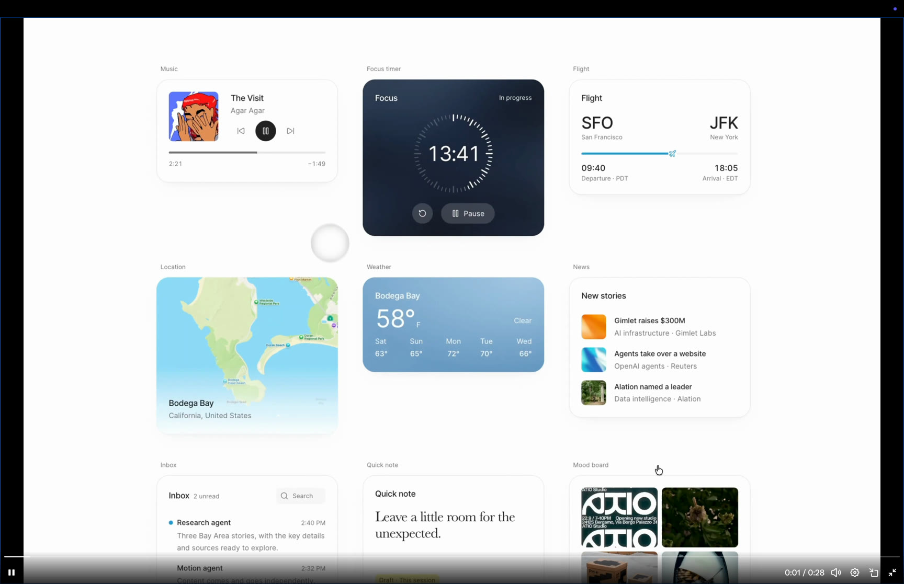
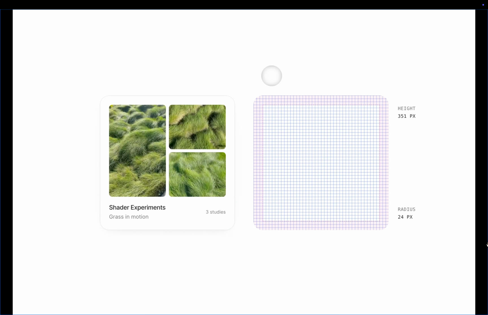

# Oncyber UI brand guide

Version 1 · 5 September 2026 · First applied to the landing page

Oncyber gives worlds room to speak. Use a quiet canvas, clear typography,
softly rounded surfaces, and precise controls. The interface should feel calm
while the content feels alive.

This is the working design reference for future UI work. The current rollout is
`/` and `/landing-carousel`; other products can adopt these foundations as they
are revised. Preserve the needs of each surface rather than copying the landing
page's layout everywhere.

Token values for the landing, lobby and studio, and how they share a base, are
in [tokens.md](tokens.md). For editor work, start with
[Building Studio features](tokens.md#building-studio-features) and the live
Studio controls at `/dev/tokens#studio`.

## Sources and what we learned

### The existing Oncyber direction

The supplied February 2023 gallery reference and the landing-page iterations
established the black exhibition canvas, centered Oncyber identity, generous
spacing, image-led cards with light captions, and a very small selection
line. The selected-card edge retains the original cyan-to-lime accent.
The current Studio also uses locally hosted Aeonik and Space Mono; the landing
now shares those typeface roles through its own scoped theme.

### The September 2026 UI recording

Reference: `Screen Recording 2026-09-05 at 11.17.50 AM.mov`, supplied by the user.
The original is on the user's Desktop; the two stills below are extracted
reference material, not Oncyber artwork. The 178 MB recording is not copied into
the repository.

Observed in the recording:

-   Cards use a consistent corner treatment across music, focus, weather, lists,
    notes, and image collages. The measurement sequence explicitly labels a
    **24 px radius**, even as heights change.
-   Titles and interface copy use a restrained sans serif. Secondary text is
    visibly quieter. A note uses a serif for editorial expression; measurement
    annotations use monospaced type.
-   Content sits on a repeatable inset. Borders are fine and low contrast, with
    a small shadow below light cards rather than a large glow.
-   Full-bleed media and inset collages coexist within the same family of shells.
    Internal image corners are smaller than the surrounding card corners.
-   Selected examples expand out of the overview, and the dimension study moves
    between different content heights while keeping the shell's radius constant.
-   Motion belongs to individual content surfaces. The focus timer, music art,
    and media can change without making their labels or controls rotate.

The exact font families, CSS spacing, and animation durations of the reference
cannot be established from the recording. The specifications below are
**Oncyber choices informed by it**, not claimed measurements of its source code.
The recording's player chrome, pointer visualization, headlines, and sample
product data are not product requirements.

## Identity

-   Use the supplied Oncyber geometry: `oncyber-original.svg` for the original
    linked-circle symbol, the Cyberloop for the orbital mark, and
    `oncyber-wordmark-white.png` for the lettering. Do not substitute a font
    or a generic mark.
-   The landing uses a 34 px symbol, a 108 px wordmark, and a 10 px gap.
    On small screens it uses the 30 px symbol alone.
-   Center the identity independently of the widths of the left and right controls.
-   Keep clear space around the mark and keep the wordmark stationary.
-   The landing arrives on the original Oncyber symbol. The first rendered
    column of gallery scrolling continuously opens its three SVG ribbons into
    the orbital Cyberloop. Continuing to browse turns the loop with the cards;
    returning to column zero restores the original symbol. Follow the cards'
    actual speed, easing and direction, including restored gallery positions.
-   Loading activity never advances the header identity. Reduced motion switches
    directly between static identities at the midpoint of the first column.
    Hidden tabs suspend drawing and catch up when shown. Keep the grid and
    stationary wordmark dimensions fixed; there is no independent header timer.

## Typography

Use **Aeonik** for language and **Space Mono** for compact utilities. The app's
local fonts are the source; no remote font service is needed.

| Role                                    | Family / weight      | Landing specification                                                           |
| --------------------------------------- | -------------------- | ------------------------------------------------------------------------------- |
| Navigation and ordinary UI              | Aeonik 400           | 14 px, 1.5 line height; 12 px on small screens                                  |
| Panel title                             | Aeonik 500           | 16 px, 1.5 line height                                                          |
| 2×2 card title                          | Aeonik 500           | 14 px / 1.4, tracking −0.01em; 12 px on small screens                           |
| 1×1 card title                          | Aeonik 500           | `clamp(16px, 1.2vw, 20px)`; 16 px on small screens                              |
| Card supporting copy                    | Aeonik 400           | 12 px / 1.5; 11 px for compact 2×2                                              |
| Large-card supporting copy              | Aeonik 400           | 12–14 px / 1.5                                                                  |
| Visit counts, grid sizes, range counter | Space Mono 400       | 10–11 px, tabular numbers                                                       |
| Small section labels                    | Space Mono 400       | 10 px, tracking 0.02em, muted color                                             |
| Editorial statement, when needed        | PP Editorial New 400 | Reserved for a short editorial moment; not used in the landing grid or controls |

Typeface registration uses `Oncyber Sans` and `Oncyber Mono` to avoid legacy
global font aliases. Load real Aeonik Regular and Medium weights. Disable
synthetic bold and italic. Use sentence case for normal interface copy.

Keep titles, descriptions, and controls level in screen space. A curved preview
does not require distorted typography: the DOM text sits above the canvas and
never tilts, rotates, or changes glyph width. Do not tighten tracking to force
a title to fit. Truncate one-line grid labels; preserve their full accessible
names. Mono is a useful utility voice, not the default for every paragraph.

## Color and material

| Token              | Value                         | Use                                           |
| ------------------ | ----------------------------- | --------------------------------------------- |
| Canvas             | `#101010`                     | Landing background and inset fields           |
| Panel              | `#191919`                     | Menus and control groups                      |
| Surface            | `#242424`                     | Selected controls and raised rows             |
| Hover              | `#2c2c2c`                     | Small, local interaction feedback             |
| Primary ink        | `#f3f3f1`                     | Main text on dark backgrounds                 |
| Secondary ink      | `#c2c2bd`                     | Ordinary supporting controls                  |
| Muted ink          | `#93938e`                     | Secondary labels on dark surfaces             |
| Fine border        | `#ffffff12`                   | Quiet surface edges                           |
| Strong border      | `#ffffff24`                   | Inputs and separators needing definition      |
| Paper              | `#fafaf8`                     | Light card captions                           |
| Paper ink          | `#20201e`                     | Card titles                                   |
| Paper secondary    | `#6b6b65`                     | Card descriptions and counts                  |
| Action blue        | `#3975ff → #2567ff → #1854e8` | Important actions only: sign in and publish   |
| Action white       | `#fafaf8` on ink `#20201e`    | An ordinary main action on a dark surface     |
| Action outline     | `#ffffff99` edge, `#f3f3f1`   | Every other action on a dark surface          |
| Accent             | `#2567ff`                     | Focus, active choice, small action marks      |
| Selected card edge | `#38efce → #ceef00`           | Full-width 2 px bottom edge with 1 px rounded sides |

The September 5 login update uses the light `#f6f6f6` dialog as the
visual reference: centered title and mark, quiet supporting copy, and rounded
outlined login controls. Oncyber keeps its existing social, email, and wallet
providers. Sign in and Studio Play/Preview actions share a blue gradient centered
on `#2567ff`, an explicit user color choice, through the `blueAction` primitive.
Since 10 November 2026 blue is reserved for important actions (sign in,
publish); see [Action buttons](#action-buttons--10-november-2026).
Dialogs keep a 24 px shell, fit within narrow/short viewports, and support keyboard
focus containment, Escape, and focus return. The login mark plays the supplied
Cyberloop sequence continuously while the modal is open, pausing in hidden tabs
and showing its still frame for reduced motion.
Email sign-in uses Firebase Authentication’s built-in email delivery, without
SendGrid. Show the inbox confirmation only after Firebase accepts the request;
keep errors on the editable form and offer a manual retry from the inbox screen.
Mail-app controls inherit the dialog’s Oncyber Sans font.

Color comes primarily from the worlds. Controls use the Sign in blue `#2567ff`
for focus and active choices. Selected cards retain the earlier cyan-to-lime
accent (`#38efce` → `#ceef00`), restored by explicit user direction on October 12,
2026. Integrate it into the caption's full lower perimeter: a 2 px bottom edge
and fine 1 px sides following the card's rounded corners. Avoid an inset floating
line or an expanding underline. Keep other ordinary controls neutral.
Use a check, position, text, or accessible state alongside color to communicate
selection. Disabled status must be written explicitly.

Use a solid dark panel with a restrained shadow:
`0 12px 32px #00000026, 0 2px 6px #00000014`.
The reference's light background is an influence on material and hierarchy;
Oncyber's landing canvas stays dark. Keep full images crisp. No large frosted
overlays or heavy top/bottom blur. A small badge directly over imagery can use
8 px backdrop blur for legibility.

## Shape, spacing, and controls

-   Card and desktop popover radius: **24 px**. Compact/mobile card radius:
    **16 px**. Controls: **12 px**. Nested items: **8 px**. Circular shapes are
    reserved for simple icon actions, not every container.
-   Work from a 4 px spacing rhythm: 4, 8, 12, 16, 20, 24, 32. Use related
    values for neighboring components rather than arbitrary offsets.
-   Desktop card caption inset: 20 px horizontally. Large cards: 18–32 px.
    Compact mobile captions: 12 px. Search panel padding: 24 px desktop,
    20 px mobile. Keep icons and text on the same optical center.
-   Sign in and Jump In share `compactActionSizing`: a 40 px minimum height,
    10 px vertical / 16 px horizontal padding, 12 px corners, and Aeonik 500 at
    13 px / 1.35. Their label/icon gap is 10 px on desktop and 7 px on small
    screens. Keep the Jump In icon within a 20 px-high box so it preserves the
    same button height; its pale surface remains distinct from Sign in blue.
-   Every action button in the app follows that one spec (see
    [Action buttons](#action-buttons--10-november-2026)).
-   Density controls use quiet, unboxed 2×2 / 1×1 text with a small active
    indicator. Do not fill the selected segment or change control dimensions
    when selected.
-   Menus use simple rows, a subtle hover background, and a check on the current
    choice. A panel title or section label establishes hierarchy before options.
-   Keep hit areas generous, especially on touch screens. Small visual icons
    should sit inside padded interactive targets; do not enlarge the icon merely
    to improve its hit area.
-   Every focusable control needs a visible focus treatment. Menus support arrow
    keys, Escape, and focus return. Icon-only controls need accessible names.

## Action buttons · 10 November 2026

One spec for every action button in the app. This is an explicit user
direction: "blue is only for important actions (sign in, publish) otherwise
white or outline. But using the same style (font size, border etc in both pills
and rectangles)".

| Part     | Value                                                    |
| -------- | -------------------------------------------------------- |
| Type     | Aeonik ("Oncyber Sans") 500, 13 px / 1.35                |
| Height   | 40 px minimum                                            |
| Padding  | 10 px vertical, 16 px horizontal                         |
| Border   | 1 px (transparent on the solid variants)                 |
| Corners  | 12 px for a rounded rectangle, fully round for a pill    |
| Icon gap | 10 px, 7 px on small screens                             |
| Focus    | 2 px `#2567ff` outline, 3 px offset                      |
| Disabled | 45% opacity, `not-allowed` cursor, and the label says so |

A pill and a rounded rectangle differ in corner radius only. Do not give a
shape its own font size, border or height.

| Variant | Look                                               | Use                         |
| ------- | -------------------------------------------------- | --------------------------- |
| Blue    | `#3975ff → #2567ff → #1854e8` gradient, white text | Important: sign in, publish |
| White   | `#fafaf8` fill, `#20201e` text                     | An ordinary main action     |
| Outline | Transparent, 1 px `#ffffff99` edge, `#f3f3f1` text | Everything else             |

White darkens to `#e7e7e2` on hover. The outline gains a `#ffffff18` fill and a
white edge on hover, and a `#ffffff24` fill when pressed.

Use at most one blue button on a screen. A dialog's confirming action is white
unless it signs the visitor in or publishes; its other action is the outline.
White and outline are for dark surfaces. Light pages (the sign-in sheet, older
pages) keep a black solid button and a light outlined one.

In code:

-   Values: [`frontend/styles/tokens/action.ts`](../../frontend/styles/tokens/action.ts)
    (`actionTokens`).
-   Primitives in [`frontend/styles/brand/index.ts`](../../frontend/styles/brand/index.ts):
    `actionButton` (layout plus the spec), `actionSpec` (the spec alone),
    `pillAction` (shape), and the variants `blueAction`, `whiteAction` and
    `outlineAction`. `ActionButton` is the same thing as a component:
    `<ActionButton $variant="white" $shape="pill">`. It defaults to the
    outline and the rounded rectangle.
-   The older families follow the spec where they are defined, so their call
    sites did not change: `NButton` (`ui/components/NButton`) and `RoundButton`
    (`components/DesignSystem/buttons`). Both stay pills. `NButton` reads its
    surface from `overrideTheme` or the page theme: on dark, solid is the white
    action and `outline` is the shared outline. `variant="blue"` gives the blue
    action. A button over a dark surface inside a light-themed page must pass
    `overrideTheme="dark"`, or it renders black on dark.
-   Live samples of every variant, shape and state: `/dev/tokens`.

Sign-in actions outside the landing are blue too: Connect wallet in the nav
dropdown, "Sign in to join a party", and Login / Sign In in the Studio
onboarding quiz. The inline error's Retry is the outline, kept compact (28 px
high, 8 px corners) so it fits inside its row.

Not yet on the spec, recorded so it is changed on purpose: the Studio's
`studioAction` buttons (38 px, 10 px corners) and its blue Preview button, which
was an earlier explicit choice; blue Collect/Offer buttons in artwork details;
the lobby's per-component buttons.

## Dialogs · 10 November 2026

Pop-ups are dark everywhere except sign in. This is an explicit user direction:
"Dark everywhere unless login, use same UI style as landing page ui / studio
panels/components". The sign-in sheet keeps the light `#f6f6f6` dialog
described under Color and material.

| Part    | Value                                                         |
| ------- | ------------------------------------------------------------- |
| Surface | Panel `#191919`, 1 px `#ffffff12` edge                        |
| Corners | 24 px, 16 px on small screens                                 |
| Shadow  | `0 12px 32px #00000026, 0 2px 6px #00000014`                  |
| Title   | Aeonik 500, 16 px / 1.5, primary ink `#f3f3f1`                |
| Copy    | Aeonik 400, 14 px / 1.5, secondary ink `#c2c2bd`              |
| Field   | Canvas `#101010` inset, 1 px `#ffffff66` edge, 12 px corners  |
| Error   | `#ff8f80` text                                                |
| Buttons | Action spec, 12 px corners: white confirms, outline otherwise |

A dialog's confirming action is solid white. It is blue only when it signs the
visitor in or publishes; no dialog does today. Contrast on the panel: title
15.8:1, copy 9.8:1, error text 7.9:1, white button text 15.6:1, outline button
edge 7.0:1, field edge 3.8:1, focus ring 3.7:1. The panel's own edge is a
quiet hairline by design (1.5:1 against black).

In code:

-   [`frontend/components/Dialogs`](../../frontend/components/Dialogs): `showInfo`,
    `showError`, `showWarning`, `showSuccess`, `showConfirm` and `showPrompt`
    are dark on every page. `styles.tsx` holds the pieces: `dialogSurface`
    (the surface, with its own font registration and `--oc-*` variables),
    `DIALOG_COLOR_SCHEMES` (the colour variables), `dialogButtons`,
    `dialogTitle` and `dialogCopy`.
-   A window built on `components/modals/Modal` or `AnimatedModal` gets the
    same surface from `className="dialog-window"`. The buy window
    (`components/modals/Transactions`) and the upload window (the uploader's
    `Loader`) use it.
-   `showModal` with a caller's own content keeps a white container on light
    pages, because a few of those panels are still light and rely on it: the
    email sign-in code and the wallet connect list (sign in stays light).
    Inside a space, the Studio and the uploader (`useDialogTheme("dark")`)
    their container is the dark surface. A caller can pass `theme: "dark"`
    (the collection editor does). Content that is dark on every page, whoever
    opens it, marks its root with `DARK_DIALOG_CONTENT` and sets
    `darkDialogColors`; the container then draws the dark surface too. The
    account dashboard and the purchase "Processing" windows do this.
-   Also dark now: the edit-profile window, the invite-cancel confirm, the
    destination buy window and both artwork windows (their styled theme is the
    dark one, `type: "dark"`, so parts inside that read the theme draw for
    dark). The My destinations dialogs (`DestinationModal`) and Submit for
    review are dark too; their light-only child parts are held to the dark
    surface by scoped rules in `DestinationModal.tsx` and `Splines.tsx` until
    those parts take the dark colours themselves. Still light: the Mint
    window (`Uploader/Modals/Mint`).
-   Live samples: `/dev/tokens`.

## Empty states · 10 November 2026

An empty list or page uses the My destinations pattern everywhere: a small
icon, one plain line that says what is missing, an optional short second line,
and one action only when there is something to do. Never an emoji, never a
sentence about what the app tried to do.

| Part        | Page (`size="page"`)                  | Inside a panel (default) |
| ----------- | ------------------------------------- | ------------------------ |
| Icon        | 24 px line glyph, `#b5b5a5`           | 20 px, same colour       |
| Line        | 18 px, -0.04em, primary ink           | 14 px, primary ink       |
| Second line | 11 px / 1.6, `#85857d`                | 12 px / 1.6, same colour |
| Action      | One shared action button, 24 px below | One shared action, 16 px |

-   Write the line as what is missing: "No price history yet.", "No activity
    yet.", "No matching destinations." Keep it to one sentence.
-   The action follows the button rule: blue only to sign in or publish, white
    for the one obvious next step (Upload destination), the outline otherwise
    (Try again, Show all destinations).
-   The empty state is `role="status"`. When the list is empty because loading
    it failed, pass `role="alert"`.
-   On the legacy light panels pass `surface="light"`: the ink and icon turn
    dark and the white and outline actions become the black solid and the dark
    outline. A panel that follows the styled-components theme can pass
    `surfaceOfTheme(useTheme())`.

In code: `EmptyState` from
[`frontend/ui/components/EmptyState`](../../frontend/ui/components/EmptyState).
`icon` takes a glyph name (`globe`, `search`, `activity`, `tag`) or your own
small icon. Live samples: `/dev/tokens`.

## Landing composition and behavior

These are established product decisions, not general rules for every Oncyber UI.

### Layout

-   Only **2×2** and **1×1**, with 2×2 as the default. No 3×2 or 3×3 option.
-   Preserve the February reference's 1×1 card: around 50% of desktop viewport
    width and a fixed 755:418 aspect ratio including its paper caption. Scale both
    dimensions together in short viewports; never stretch the card to fill the
    available height. Keep the header region 30.6svh, separate action row 10.6svh,
    and footer region 17.8svh. Mobile adapts to the available screen.
-   The signed-in header shows the username above a muted wallet name/address,
    with a circular avatar on the right. The group opens the account menu, with
    My spaces and My destinations as separate links. Compact screens keep the
    avatar and the full accessible account label.
-   The enlarged desktop 2×2 grid uses up to 78% of viewport width, a 20 px
    gap, and height-aware bounds. Compact screens use up to 88% and 12 px gaps.
    Do not reintroduce small cards surrounded by unused grid space.
-   Keep header and footer positions stable across browse and Create. The Create
    button changes the grid's data, not the entire page composition.
-   Cards stay rectangular and use ordinary cover images only. Do not load 360 captures, render panorama fallbacks, or offer a 360 preview filter in this grid. No guestbook action.
-   Use one consistent corner radius in both WebGL and the DOM. Caption and image
    must meet cleanly, with no double rounding or seam at their shared edge.

### Selection and movement

-   A subtle cylinder bends the image strip horizontally. Default radius is
    3.5 times the viewport width. This is the fixed presentation; there is no
    curved/flat view switch. Text remains level and legible, including in the
    image-only fallback used when WebGL is unavailable.
-   Wheel up/down moves horizontally. Touch and mouse drag work on the same
    viewport. Every wheel gesture has a card landing from its first event. Update
    that estimate from input speed and momentum while keeping one continuous
    velocity. Cruise past intermediate columns and brake into the predicted
    landing. Ending input only closes the gesture; it must never start a snap,
    select another target, or change the animation speed. Absorb the remaining
    momentum tail; fresh input and deliberate reversals take control immediately.
    Drag release settles ahead, never backward to a nearer boundary. Footer
    controls move by **one column**, never a whole 2×2 page.
-   Native `scrollLeft` is the position source for rendering. The scrollbar is hidden; wheel, drag, keyboard, and navigation controls remain available.
    Never give the cards a separate animated position that drifts from the viewport.
-   Opening a published world fades the screen to black over 160 ms, then shows
    the existing loading tunnel. Do not expand or reload the preview image.
    Route loading starts on activation alongside the fade, and tunnel code loads
    during it. The bridge survives route loading and cancels on Back or Escape.
    Reduced motion uses black without animation. This is the September 16 user
    update; the idle grid layout stays unchanged.
-   Exactly one card shows the rounded lower gradient border. Hover, focus, and arrow keys can
    change it. Enter opens that selected destination, including during a scroll.
-   In 2×2, up/down changes rows and left/right changes columns. Scroll only when
    the selected card moves outside the visible grid. Stop at row/content bounds.
-   In 1×1, right/down advances and left/up goes back. Page Up/Down and the footer
    arrows still move one column. Keep the selection stable during rapid input.
-   Keep the WebGL renderer and bounded image cache alive while search results change or become empty. Reuse cached covers synchronously and never reset the canvas drawing buffer for unchanged dimensions. Render updated card positions before painting their captions.
-   Retain per-mode position/selection when switching browse and Create. Filters
    and density changes reset the relevant grid state predictably.

### Creation and discovery

-   Popular, Latest, Oncyber Labs and filtered searches fetch the next page automatically within three screens of the loaded end. Append without restarting scroll/drag motion or resetting selection. Keep only nearby card elements mounted and reuse the bounded WebGL pool. Stop at the true end of each feed; Staff picks already arrives as a complete set. Requests are serialized and stale pages are ignored after filters change. A failed or repeated cursor pauses automatic pagination and exposes a retry action.
-   Public exhibits without custom cover images use the original destination preview, including legacy `_v2` room IDs. Resolve from the lightweight cached public preview index, without delaying the gallery or fetching a destination per card. Preserve uploaded exhibit covers. If no destination preview exists or its image fails, use a stable white line-art mark on black in `frontend/public/brand/world-placeholders/`. The six `mark-N-gpt.webp` fallback assets were regenerated with GPT Image from the user-provided `twojs.webp` reference on September 16, 2026; lossless WebP preserves the crisp white edges. DOM and WebGL share this image order, with no 360 fallback.
-   Create opens the gallery destination catalog immediately. This September 9
    rollout is for existing Oncyber gallery users: hide the type chooser and
    video, game, and Gaussian creation entries, including the Studio menu entry.
    Keep the standard gallery Studio tools and the Blank canvas gallery option.
    Create again or Escape returns directly to browsing, including empty searches.
-   The gallery picker is one continuous catalog: usable rooms and Blank canvas
    first, then collectible rooms. Do not add a “Choose your room” heading or
    availability tabs. Show Free, Owned, Not collected, or a temporary
    ownership-check label as a small persistent pill on each template image.
    Search and category controls filter the full catalog; old availability URL
    parameters must not hide rooms. Ownership refreshes automatically on return
    and every 30 seconds while visible.
-   White Cube, Wolfgang №2, Wolfgang №2 Dark, Cyber Loft, Cyber Classic, and Altitude use GPT Image restorations of their original previews in `frontend/public/landing-build/gallery-previews/`. Preserve their original composition and room identity; use these sharp local WebP assets for default covers in search and Studio. Published-gallery search cards without uploaded covers resolve these restorations directly, including legacy `_v2` room IDs, without waiting for the remote preview catalog. Custom exhibit uploads still take precedence.
-   Cyber Warehouse uses its captured architectural cover at `frontend/public/landing-build/cyber-warehouse.jpg`, replacing the old cat placeholder. Use the same cover in template cards and room details.
-   `/studio/new-gallery` opens the same gallery picker. Previous game, Gaussian,
    and type-chooser links now open galleries for this rollout. Select a usable
    destination to continue in the usual Oncyber Studio; collectible rooms keep
    their ownership details and marketplace links.
-   My destinations replaces the old destinations listing at `/destinations`
    with the shared 2×2 / 1×1 grid, search, and selection behavior. Show each
    destination's upload or publication status on its card. Uploaded includes
    destinations still in testing, review, or preparation; Published includes
    deployed destinations. Preserve status, contract, and distribution filters.
    Details retain the destination's metadata and the actions appropriate to its
    status, including editing, testing, review, and minting. Upload remains
    available from the same page.
-   Header, search, account, grid controls, and card geometry are shared in Create.
    In the template catalog, the `/` dropdown uses the same UI and
    filters space categories (All spaces, Free, Oncyber Labs, Curated, & Friends,
    Community, Ethereum, Polygon). Category and template search
    combine and persist in the URL without leaving the catalog. Applying a world
    search or feed elsewhere returns to browsing. Escape exits Create.
-   Search lives at the bottom center, Create + at the top left, and the quiet
    2×2 / 1×1 grid switch at the bottom left. The visible range counter stays
    hidden but remains available to assistive technology. Keep Create as the
    sole creation action; omit the separate Create game action. Sign in stays
    top right. There is no separate Filters or Popular button.
-   The search field is 48 px high with 16 px corners on desktop. Its width is
    34vw, bounded to 260–440 px. Mobile uses a 44 px field with 14 px corners,
    20 px side margins, and a separate row above the footer controls. Reserve at
    least 144 px for the mobile footer so the rows never overlap.
-   World search filters loaded cards on each keystroke. After a 300 ms pause,
    Firestore search adds matches to the same grid; keep local matches visible during
    requests and failures. Global matching uses bounded queries against existing
    title, curator, and URL-prefix indexes, with ordinary Firestore reads and no
    Algolia service. This supports series such as Cyber Spotlight №1–№3 without
    loading the whole catalogue. It is prefix search, not fuzzy/full-text search;
    loaded cards still match descriptions and other metadata immediately. Clearing restores the loaded browse feed immediately.
    This is an explicit user constraint: never add result counts, query chips,
    clear rows, or search-service notices above the grid. Header, grid, footer,
    and search geometry stay the same throughout search.
-   Discovery search has no submit button; live search and Enter submission
    remain available. The clear action restores an empty query. ⌘K or Ctrl+K
    focuses the bottom field. `/` inside search or outside other editable fields
    opens the Popular/feed dropdown above search, without adding a slash to the
    query. In Create it opens the template categories. Arrow keys navigate the
    choices, Enter selects, and Escape or selection returns focus to search.
    Keep search mounted during loading and empty results. Template search still
    filters the complete catalog, including collectible rooms and Blank canvas.
    Preserve URL-backed search and active non-text filters.
-   The feed dropdown replaces the advanced filter popup. Its width matches the
    bottom search field and its active choice has a small check. These positions,
    the slash trigger, and matching Sign in blue are explicit user direction
    (October 12, 2026).

## Motion

The recording motivates continuity; these timings are our implementation choices:

| Motion                       | Token / behavior                                                                                                     |
| ---------------------------- | -------------------------------------------------------------------------------------------------------------------- |
| Hover color or fill          | 120 ms                                                                                                               |
| Chevron and small affordance | 180 ms                                                                                                               |
| Popover entry                | 220 ms, opacity plus 4 px vertical travel                                                                            |
| Easing                       | `cubic-bezier(0.2, 0.8, 0.2, 1)`                                                                                     |
| Carousel settling            | One requestAnimationFrame controller; continuous velocity toward the selected column, shared by content and captions |
| Reduced motion               | Same static curve, automatic scroll, zero token durations                                                            |

Animate opacity and transform where useful; avoid animating typography, layout
width, or the shared navigation. Selection changes immediately so Enter always
has one clear target. The incoming experience-card edge fades in over 180 ms
without moving or scaling. Its full-width border remains aligned with the rounded
caption. The outgoing edge hides immediately, so gradients never crossfade
between cards. Reduced motion shows the selected edge immediately.
Do not add decorative motion to every surface just because the reference
contains animated media.

## Implementation and maintenance

-   [Tokens](../../frontend/styles/brand/tokens.ts): numeric/color source shared by
    UI styles and WebGL card metrics.
-   [Scoped foundation](../../frontend/styles/brand/index.ts): font registration,
    CSS variables, material, motion, and responsive radius.
-   [Landing implementation](../../frontend/features/landing-carousel/index.tsx)
    applies the foundation to its root. Other routes are not globally restyled.
-   [Card geometry](../../frontend/features/landing-carousel/three/layout.ts)
    supplies both projection and caption bounds.
-   [Visual specimen](specimen.html) demonstrates the type, palette, card shell,
    and control family using local assets. It is a documentation sample.

For new UI work, read this guide, reuse the token source, and decide which
surface-specific composition is appropriate. Check both densities, narrow
screens, search/feed menus, browse/Create parity, keyboard selection, and
reduced motion when changing the landing. Verify the real rendered result.

When a direction changes, update this guide and its tokens together. Record
whether a value is observed in a reference, an Oncyber adaptation, or an explicit
user constraint. Keep the 24 px reference radius, typography roles, small accent
budget, and stable interaction geometry recognizable as the system grows.

## Shared lobby · 7 October 2026

The landing's bottom-right **Jump In** control opens the shared lobby in place.
Browse cards and search fade away while the Oncyber logo and account/sign-in
control remain. Returning restores the discovery filters and grid.

The direction is a minimal black environment. Use a near-black sky, a graphite floor, fine
two-meter grid lines, a soft light pool around the local avatar and an almost
invisible horizon. Keep the space open and free of architecture or decorative
objects. The avatars are the visual focus. The grid stays anchored in world
space; pixel derivatives smooth its edges, and both the grid and floor fade
before the horizon. A quiet cool edge light separates dark clothes from the
background, while soft black contact shadows ground feet.

The shared palette and distances live in
[`lobbyEnvironment.ts`](../../frontend/features/lobby/lobbyEnvironment.ts).
WebGPU/modern WebGL2 use a TSL floor; legacy WebGL uses the same math in GLSL.
The grid and light pool reuse one floor draw without a new asset, reflection
pass or shadow map. The pool's focus references the local avatar's existing
presentation position. The environment adds one inexpensive directional light.

The lobby uses a small Three.js scene with the actual Oncyber VRM avatars and
retargeted locomotion clips. The local visitor remains visible in third
person, including when alone. Movement stays on a flat floor; jumps return to
that floor. The full exhibit engine, `Exhibit3DDisplay` and world/physics
initialization are excluded from this lobby.

Prepare the visitor's saved avatar and animation assets from the landing after
its initial paint, during idle time. Jump In hover/focus can start the same
preparation sooner. This work must not create a world, join multiplayer or ask
for the microphone. Keep the ordinary landing interactive while it runs.

Use the Oncyber experience layout: **Lobby** and back at the top left, chat at
the bottom left, and a compact control row centered along the bottom.
Use the same 40 px charcoal, 12 px-corner button family as the header and chat,
with 18 px icons and 8 px gaps. Active controls use a slightly lighter charcoal
fill and clearer border; avoid white circular selection discs and hover scaling.
Use the image-generated `LobbyDockIcon` set for the five dock controls, displayed
at 22 px in the same quiet white as the Global planet. The PNG alpha masks live
under `frontend/public/lobby/icons/generated-v3/`, with avatar and people
refinements in `generated-v4/`, and use currentColor in the UI.
Use one alpha mask per icon, with the same proportions in the lobby and native
preview. A rounded capsule microphone, head-and-shoulders avatar with one
Saturn-like orbit ring, paired people with hollow outlined heads, symmetrical
smiley, and four rounded tiles keep each action clear at small sizes. Substantial
rounded strokes and open negative space echo the Global planet. Keep the heads
transparent inside; avoid extra facial marks, extra rings, and tiny decorations.
Keep quiet keyboard/hover tooltips and a small outlined presence badge. On phones,
use 44 px targets and 6 px gaps so all five controls fit a 320 px viewport.
Emotes, people, voice and Explore remain connected to the lightweight lobby. Keep touch movement available. Discovery
belongs to Explore in the center panel, not to geometry in the world. People,
text chat and voice use Oncyber's existing multiplayer/signaling services.
Voice starts off and asks for a microphone only from the visitor's voice action.

Travel preserves the shared header and respects reduced motion. Selecting a solo
destination starts its hidden document and asset loading immediately, alongside
the camera turn and authored animation. Start dimming the lobby environment
on the attack's clap; keep the avatar, approved group and circle beneath them
visible as the attack and crouch continue against black. Group travel retains its preparation and
admission handshake.
See [in-app space navigation](../in-app-space-navigation.md) for the supported
runtime and readiness boundaries.

Use a 40 px charcoal back button beside Lobby with 12 px corners, a fine
white border, and the landing icon's thin back arrow. Keep the shared header
identity white; labels and account details use quiet, readable light grays.

The bottom-left chat composer is one compact charcoal row, about 287 px wide
and 40 px tall, with a fine border and 12 px corners. Put the current
conversation's globe or portrait and small chevron inside the left end of the
bar, followed by the message input. Keep desktop text at 13 px, placeholders
quiet, and focus a subtle gray fill. On phones the bar is 44 px tall with
16 px input text, above the central dock with safe-area clearance. Keep this
conversation control out of the central dock.

The composer opens in message mode. Clicking the current conversation fades
its frame away over 180 ms and reveals a horizontally scrolling strip of
compact portrait-and-name pills in the same footprint. Let the pills float
individually over the world with subtle charcoal fills. Keep compact search
and close icons at the right end, with a 14 px close glyph inside a 28 px hit
area. Preserve the row's position and dimensions throughout; this frame fade
does not move the whole composer. Hide the scrollbar while preserving wheel,
trackpad, and keyboard navigation. Pills are 28 px high on desktop and 30 px
on phones, with quiet gray selection and keyboard focus.
Search restores the compact framed input in place and moves its filtered
people pills above it, floating without an enclosing results box. Selecting a
person opens their conversation. The close control returns from search to
browsing, then from browsing to the current conversation. Clicking outside
the picker restores the current message draft and previous history visibility
without moving focus away from the clicked control.

The conversation selector shows the hover/focus hint “Press Tab to switch
convo”. Plain Tab from the message input, or while hovering or focusing the
selector, opens the picker and focuses the current conversation. Leave other
editors and dialogs alone. Left/Right arrows browse people, Enter opens the
highlighted conversation, and Arrow Down opens search. Arrow Up from search
returns to the people list; Left/Right from search moves to the adjacent user
without opening their chat. Shift+Tab and ordinary Tab inside search retain
normal focus navigation. Escape from search returns to unfiltered browsing;
Escape from browsing restores the current message input and draft. Escape
from the message input closes the history and focuses the conversation control.

Show the latest two messages for the hovered or keyboard-highlighted
conversation directly above the bar, with quiet sender labels and truncated
single-line text. Previewing preserves drafts and unread indicators, and never
opens or sends a conversation. Full history uses compact 12 px inline
name-and-message rows with 18 px circular portraits or initials and no message
bubbles. Use the shared action blue (`#2567ff`) for unread dots on the selector
and contact pills. Clear unread only when the latest messages are visible;
preserve scroll position while someone reads older messages.

Animate only the preview, filtered people list, or conversation history above
the composer: a 160 ms downward fade (18 px, subtle 0.985 scale), a 100 ms hidden
pause, and a soft 260 ms upward entrance. Clip this motion above the bar and
keep the bar's position and dimensions fixed. Swap its input mode and selected
conversation during the pause, then restore keyboard focus on entrance. Keep
drafts, cancel pending switches on Escape or leaving the lobby, and clear
unread only after the conversation is visible. Reduced motion switches
immediately.

Keep native avatar rendering with sRGB output, no filmic tone mapping and
Lambert body materials. Enable MSAA (4× in the modern renderer) and render at
device pixel density capped at 2× for crisp edges on Retina displays. With the current Oncyber fork's legacy light scaling,
white ambient/key intensities are 0.42 and 0.9, with a restrained cool edge
light at 0.22. The modern renderer uses the equivalent π-scaled intensities.
Contact shadows use black, so they darken the floor rather than adding a halo.

The avatar control opens a horizontally scrolling grid using the existing
portrait, name and selection-check cards. Each card uses the shared `promptGlass`
material with a bounded 4 px blur, translucent tint, static lens highlights and
a glass border that brightens on hover/selection. Keep portraits transparent
and captions legible over a subtle dark gradient; preserve the material's
reduced-transparency and forced-colors fallbacks.
Remove the catalog thumbnails' baked-in slate-blue backdrop with the shared
image-only color key, preserving the artwork's colors. Show four columns and
two rows in the shared 656 px rail, with 8 px gaps and clipped edge gutters. Use overflow clipping instead of a CSS mask so the glass can blur the
world behind it. Cards are 146 px at full width and shrink to fit four columns
on smaller screens. Leave 24 px of horizontal padding for the 3D projection.
Short viewports reduce portrait height while keeping the shared panel width. Page
controls advance four columns at a time. Keep free scrolling without CSS snap,
which would align projected bounds instead of the grid. Follow the animation picker's quiet
heading and browse controls, without an enclosing panel. Arrange whole cards
on the shared convex horizontal 3D arc under a 1000 px perspective. The middle
comes forward while the outer columns turn away at 12 degrees;
cap offscreen rotation at 16 degrees. Use cylinder geometry for both depth and
yaw, with no screen-plane roll or vertical lift. Portraits, glass borders and
11 px mono captions transform together. Keep 16 px vertical padding for
projected corners and focus outlines. Update the curve only while scrolling
or resizing. Keep the small progress track, selected/loading label and Done
control below.

Dragging, swiping, wheel input and page controls browse without changing the
avatar. Arrow keys move focus through the visible grid; Home/End reach its
first/last choice. Click, Enter or Space selects the focused card. Reveal the
focused card only as far as needed instead of forcing every choice to center.
Keep the normal world camera framing used by the avatar picker. A loaded replacement faces the camera and makes a full
turn over two seconds with the original elastic easing. Keep the previous
avatar visible while the new one loads. Done/Escape restores the dock, chat and
movement, returning focus to the avatar control. Reduced motion skips entrance,
smooth scrolling and the avatar turn. The floor grid and gradient reuse the
existing ground draw and add no world assets or shadow-map pass.

Native space preview uses the same control family in a detached avatar/settings
sidebar: a 360 px charcoal panel with 24 px corners, semantic segmented tabs,
named three-column avatar tiles, and quiet selected/focus fills. Keep uploads,
owned avatars, size controls and settings available in one scrolling body.
Keyboard navigation stays inside panel controls; closing returns focus to the
opener. Escape must not cancel an avatar edit during IME composition.

The lightweight lobby defaults to an isolated WebGPU/TSL renderer with native
VRM animations and shared crowd batches. Keep its lighting, floor, avatar-picker
presentation and social UI identical across the modern WebGL2 compatibility
path. The gallery engine retains its existing renderer. GPU backend details
belong in development diagnostics, not the lobby UI.

### Lobby travel · 8 October 2026

Initial isolation settles the avatar into ready idle, followed by the supplied
magic attack and crouch-down. Keep its feet anchored and loop crouch idle while
the world assembles from black as rotating 3D tiles inside the destination
scene. When assembly finishes, play the supplied stand-up and blend into the
existing ready idle; remain in that idle until movement. The development preview keeps one avatar/camera in a real architectural
sample scene throughout assembly. Keep
self and the approved party readable; do not cover the screen with a grid,
composite SVG apertures, or fade the experience through a CSS opacity mask.
The renderer owns the effect and its completion. Keep destination and
Cancel/Escape controls available during admission and reveal. Reduced motion
uses immediate entry after admission.
See [navigation implementation](../in-app-space-navigation.md#lobby-travel-cinematic--8-october-2026)
for renderer support, readiness and party boundaries.

### Shared icons and cube reveal · 8 October update

The same ten-icon control family now serves lobby, native galleries and
embedded content. Reuse the six established lobby glyphs and the generated
More, Permissions, Reload and Info artwork. `ExperienceControlIcon` owns their
bounded name mapping and 22 px currentColor masks; runtime action names map to
this same family. Hover, selected and disabled appearance belongs to the button.
Do not change utility arrows or creator-provided game art into toolbar glyphs.
Asset prompts are retained in
[generated-v2](../../frontend/public/icons/generated-v2/README.md).

World-tile travel is a scene operation, with real geometry and depth, not a
screen transition. Native arrival holds framing and crouch idle through geometry
assembly, then plays the one-second stand-up and a 180ms ready-idle blend while
settling behind the avatar with collision clearance before releasing movement. An explicitly selected first-person view
retains its mode; reduced motion skips the orbit duration.
The renderer clips ordinary static meshes and compatible standard instanced
meshes into world-space cells. Player subtrees stay separate; unsupported
skinned, morph-target, custom ShaderMaterial and over-budget world meshes appear
at completion. Preserve original world
assets and restore their visibility when travel finishes or is cancelled. The destination callback must finish its rendering work
before the host releases input and audio. Opaque embedded worlds without that
callback switch immediately; do not imitate missing renderer support with a
fade or screen-cover effect. The shared controls remain outside the renderer.

### Player-origin world transition · 10 October 2026

Keep the avatar and approved group visible throughout. The 12 October update
keeps the 600ms ready-idle/camera turn, 3.533s magic attack and 1s crouch-down,
while overlapping **lights out** with the attack. Start dimming the intact
graphite floor, grid, light pool and horizon on the clap at 2,766.667ms from
departure (attack frame 65 at 30fps). The 700ms fade reaches exact black at
3,466.667ms. Keep the travel circle and its glow invisible before the clap.
On that same cue, show the dim white ring beneath the group and start its soft
white highlight orbit; share `TRAVEL_DISSOLVE_AT_MS` (2,766.667ms from departure)
with the lights-out timing. Keep it visible against black while travelling and
loading. Use a smooth one-second lap, slowing at the same point halfway around
and accelerating again. Complete exactly one revolution per speed cycle so the
slow point stays fixed. It indicates activity, not a loading percentage. Reduced
motion shows the ring immediately with a stationary highlight, skipping the clap
delay. Do not rotate or disassemble the outgoing lobby floor. Keep avatar
lighting readable as the attack and crouch continue.

The hidden destination document and assets start loading immediately on
selection. After at least 150ms of black and two animation-frame boundaries
(approximately 3.62s after selection), native entry and preparation can overlap
the remaining animation. Final staging and reveal still wait for the complete
attack and crouch-down, a minimum
5,133.333ms departure. Slower loading or admission extends the crouch-idle hold.
Cancel restores the ordinary lobby immediately. The shared header remains
outside the renderer effect.

Once the destination has staged and passed admission, reveal its world from the
player's feet outward over 1.8 seconds, including walls and overhead surfaces.
Cut supported surfaces into small pieces, with bounded adaptations for large
worlds. Let each piece charge with soft blue/lavender glow, make a compact
quarter-turn around its own surface, and settle into its original position. Keep
translation within a few centimetres; walls should not fly through a small room.
Overlapping turns, varied
axes and small stable timing changes keep the wave loose. Keep camera and avatar
anchored through arrival, then stand up, blend into ready idle and settle the
camera behind the player before movement. Use the authored crouch depth; do not
add a levitation offset or replace it with the old seated emote. The four supplied
clips and the reused standing idle are documented in
[travel animations](../travel-animations.md). In tight interiors, choose collision-safe room-facing
framing before the reveal, keep avatar scale and camera focus steady through
handoff, and ease back to normal framing only when there is room. Do not grow the
avatar into a doorway-clamped camera. Glow belongs to the 3D fragments and obeys depth.
Reverse faces use the shared neutral dark gradient, without copying artwork or
baked surface imagery onto their backs. Preserve clipped shapes on angled
geometry and restore the intact source world at completion. Image backdrops stay
stationary, fading in behind the formed room late in arrival and dimming early on
departure. Do not split an image sky into oversized architectural panels.

Back closes the native world's tiles inward from the outside toward the player's
feet, then uses the lobby's outward floor
assembly. Prepare the lobby's grounded idle before showing its canvas; never
flash the retained departure pose. Match the outgoing avatar framing at the
handoff and smoothly settle into the rear camera during the 1.1-second assembly.
Keep the same idle animation clock when movement resumes. Reduced motion skips
animated durations. The lights-out change applies to the outgoing lobby only.

### Native gallery consistency · 9 October follow-up

Align the chat composer and action dock on one optical centre and bottom inset.
From 681–1100 px, keep mic, people, search and More in the native dock;
avatars and emotes live in More to leave room for chat beside it. On phones,
keep square 44 px controls: mic, Chat, avatars, emotes, search and More. People
moves into More. Center the controls as a compact group with 8 px gaps (4 px on
the narrowest phones), never distributed across the screen. Opening Chat slides
Mic and Chat left while the other actions fade away, revealing the composer to
the right of mic and Chat on the same baseline. Closing Chat restores the
actions and preserves the unsent draft. Use 16 px safe-area-aware gutters,
16 px input text, a 14 px placeholder and 13 px messages. Message contrast uses
a thin, unblurred text edge, never a soft glow or a solid message container.
Hide desktop shortcut hints on phones and offer Send on the software keyboard.
Native phone Avatars, Animations and More share 16 px safe gutters, 16 px corners,
a short upward entrance and a bounded scrolling body above the visible dock.
The active dock icon becomes a close cross; only one panel is open at a time.
Animations use a four-column vertical tap grid on phones, with Stop in the footer;
keyboard assignment and the horizontal shortcut rail stay on desktop.

In-world artwork details remain over the live 3D view at desktop and mobile
sizes. Do not switch ordinary artwork details into a centered full modal. Keep a
compact title and one-line description above the artist and collector credits,
with an explicit See more / See less control. Use a dark transparent floor fade
behind the metadata so it stays readable over bright rooms; keep the central art
clear. On wide screens, group the credits at left, actions in the middle and
activity at right. Stack the same interface on phones. Preserve Escape/Close,
keyboard focus return and touch access to the full description. Arrival cameras
must check destination walls and doors, preserve the current camera mode, and
settle into ordinary framing only after the geometry has assembled.

### Lobby groups

The conversation picker includes a quiet plus control for creating a group.
Group pills use the shared people artwork. The conversation heading opens a
compact graphite modal for membership, direct invitations, a share link, and
leaving. Group history and drafts stay separate from Global and individual DMs.
Travel invitations sit in the chat area with explicit Join trip / Stay here
choices; Go together seals the people who accepted. Keep the initiator centered
and still while others briefly teleport into their idle formation. Shared
motion respects the existing reduced-motion preference. After arrival, a small
bottom-left group control keeps the conversation accessible above native chat.

### Jump In portal glyph · 5 November 2026

Jump In uses the white runner crossing a tilted portal with a rainbow floor
trail in `frontend/public/icons/generated-v3/jump-in-portal-rainbow-bold.svg`.
Keep the filled white runner, transparent background and open portal interior.
The portal path has an added 21.6-unit white stroke so its rim remains legible at
24–28 px in the landing button. The search and Jump In controls scale together
from 48 px to 40 px high as the viewport narrows or shortens, with proportionate
padding, gaps and corners. Keep mobile input text at 16 px. Limit the centered
search width so it stays clear of the paging arrows on narrow desktops.
Asset and refinement notes are recorded beside it in `generated-v3/README.md`.

### Animation picker · 14 October 2026

Lobby and native galleries share the Animations picker: a centered, horizontal
two-row grid up to 656 px wide. Each row shows eight compact Liquid Glass cards
on desktop, with four columns on phones. The top row holds nine numbered shortcuts;
the second row is the animation library. Both rows scroll independently. Cards
follow the same 12-degree convex 3D arc as the avatar picker, with
light glass borders and compact mono labels. Sitting and Sit & talk are excluded;
Floor sitting remains available. Keep all nine shortcuts accessible through
scrolling and keys 1–9, including the offscreen ninth slot. Support touch, wheel
and keyboard browsing. Recalculate curvature only on scroll and resize, without
extra renderers or an idle animation loop.
The footer uses the shared 368 px Liquid Glass control bar at the dock baseline so desktop chat stays clear.
On phones, preserve the composer gap between the grid and footer.

Drag a library move onto 1–9 to assign it, or drag between assigned slots to swap.
Shift + 1–9 assigns the focused library move; the Assign control offers a
select-move, then select-slot flow on touch. Ordinary clicks and number keys play
the saved move. Assigning must keep the picker open and never trigger playback.
Persist the nine animation names locally and share them between the lobby and
native galleries, resolving original engine IDs at playback. Keep defaults and
valid unique assignments when older or invalid saved preferences are found.

Each move uses Summer’s actual avatar silhouette, posed from its native animation.
Keep the cap, dark goggles and X eyes recognizable, with a soft pearl finish and
quiet dark shorts and shoes. Show its characteristic pose at rest and animate
only while hovered or focused; reduced motion and background tabs keep the still
pose. Render the model offline into transparent WebP icons, loading only the
active move’s animated image and reusing the browser cache. Keep the still visible
until that image loads, and retain it if loading fails. Do not create extra 3D
renderers or load avatar models for these thumbnails.
Keep the label and 1–9 shortcut stationary. Include Stop animation, Escape,
visible keyboard focus and focus return to the opener.

### Shared dock panels and arrival · 21 October 2026

Avatar, animation, world search and NFT collection pickers share a 656 px maximum
width. Use the 368 px compact variant for People and Flash sign-in/empty states. `lobbyPanelStyles.ts` owns the shared dimensions, 32 px heading row,
12 px card/control corners, 16 px compact surface corners, fine glass edges and
368 px footer. Use the existing `promptGlass` material with bounded 4 px blur,
including its reduced-transparency and forced-colors fallbacks. Preserve the
world behind separate cards; do not add one large opaque backdrop to the rails.

`lobbyPanelCurve.ts` owns the shared convex cylinder: 12-degree visible edges,
16-degree offscreen cap, 1000 px perspective and 24 px side gutters. Recalculate
only during scroll/resize and batch layout reads before style writes. Keep the
existing differences in density: four avatar columns, eight animation columns
(four on phones), and larger world previews. Compact informational panels use
the same surface and controls without warping their paragraphs or form fields.

Travel text stands behind the avatar as large type (5 November 2026). The
destination name is a flat plane about 2.6 m behind the avatar along the travel
camera's view, cap centre at 1.85 m and 1 m cap height, so the avatar's head
overlaps the lower half of the letters. The loading stage sits above it in small
mono caps with the percent. Both face the camera (no keystone) and fit 86% of
the visible width on phones. `lobbyTokens.world` holds these "UI in 3D" values.
`travelBackdropText.ts` draws each line once per text change into a canvas
sized to about one texel per screen pixel (capped at 8192 px), used as an alpha
map so edges stay clean under MSAA and supersampling. The floor circle keeps only
its progress band.

Keep a simple white Cancel button at bottom center, using a white fill,
dark text and 12 px corners. Keep the Escape shortcut without a visible keycap. The DOM live
status remains available to screen readers when the floor text is visible. Hide
the visible text fallback only after the current journey renders its floor label;
restore it before the halo appears, on renderer loss, or during native destination
arrival and return where no floor label exists. Use actual journey stages: opening,
preparing arrival, arriving, or welcome back. Avoid “Your world is ready.” Preserve
keyboard cancellation, full accessible world names and the travel focus target.

### Native space utility panels · 9 November 2026

Menus reached through More reuse `NativeVisitorPanel` and the lobby panel
surface. Settings opens directly, without the avatar/profile wrapper. Keep one
heading and close button per panel; desktop utilities also link back to More.
Use the shared utility rows, buttons, fields and empty states for space controls,
sharing, feedback and voice requests. Avoid nested legacy panel backgrounds or
large icon tiles. Panels scroll internally, remain below the top bar, and leave
the bottom chat and toolbar visible, including at phone widths. Escape closes
the panel and returns keyboard focus to its opener.
