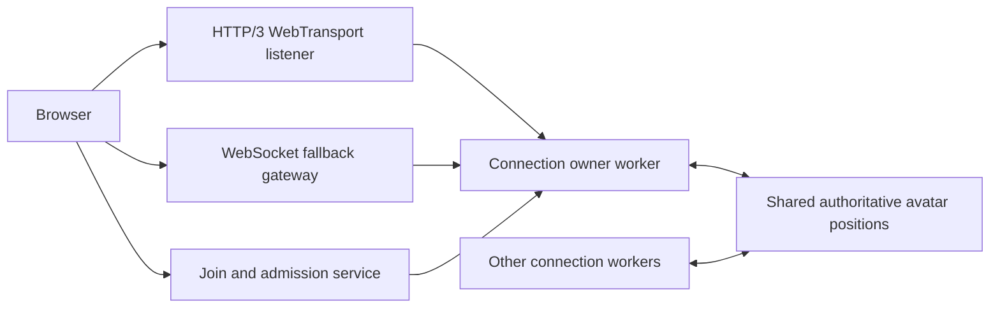

# Shared lobby world, protocol v2

This is the lobby's new multiplayer server, being built now. It replaces the
protocol-v1 crowd lobby. It makes one logical room span multiple CPU workers. Every worker can
see actors owned by every other worker; joining a different gateway does not put
someone in a separate overflow room. The existing protocol-v1 lobby and gallery
multiplayer remain available independently.

The current implementation uses one host and shared memory. It is not a
multi-machine or globally replicated world, and a host failure loses ephemeral
room state. Regional gateways and cross-host ownership are separate work.

## State and connection ownership



Each actor has one writer. Its connection owner validates movement and writes a
shared-memory slot. Readers use an atomic sequence stamp to avoid accepting torn
poses. The parent coordinates admission, metadata and low-rate social messages;
movement is not broadcast to every worker through per-player IPC messages.

Each worker assigns connection phases locally to spread interest, roster and
acknowledgement work across ticks. Using actor ID modulo alone synchronized work
when the worker count shared the same divisor. Encoded avatar buffers are reused;
spatial buckets rebuild only when membership or cell occupancy changes. Metrics
include the latest tick's simulation, refresh, interest and delivery durations.

Workers divide viewer-specific interest selection and packet delivery, even when
everyone occupies the same spatial cell. Spatial buckets bound candidate searches;
retention keeps the visible selection stable. The detailed interest set is capped
at 128 remote actors, with up to eight explicit nearby interest pins. Above 4,096
members it decreases to 64, returning to 128 below 3,072. This hysteresis prevents
repeated switching near the threshold. The server announces changes through
`lobby-config`; the client keeps its prediction and interpolation state and
removes actors on explicit roster leaves. These are per-viewer detail limits,
separate from total room membership. A browser does not receive or render all
10,000 individual avatars from this network path.

The initial update budget is 16 actors at 20 Hz, the next 32 at 5 Hz and the next
80 at 2 Hz, plus periodic state confirmation. The high-density budget uses eight
at 20 Hz, the next 24 at 5 Hz and the final 32 at 2 Hz. These are ranked priority bands:
in a dense crowd a low-priority actor can still be physically nearby. Client
interpolation adapts to that cadence. Lower-rate moving actors have more
presentation delay; near-priority motion retains the shorter delay. Local motion
continues immediately with server reconciliation. New clients negotiate
`input-v1`: browser and server run the same fixed 60 Hz collision-free controller
from quantized inputs. Acknowledgements include authoritative state and the last
consumed input; the browser replays its remaining inputs and smooths presentation
corrections. Between ticks, the browser predicts a fractional presentation step
without changing its canonical simulation history. This controller covers the
void's floor, boundaries, movement and jumps, not arbitrary world physics.

Every movement datagram repeats up to 12 recent inputs (200 ms), with three
seconds of bounded client history. Server simulation has bounded time credit;
clients cannot advance time by flooding inputs. Missing inputs get a 100 ms
reordering grace before neutral input fills a gap. An unbounded history gap resets
the input timeline at the authoritative position. These rules tolerate ordinary
loss but cannot hide sustained outages.

Clients also negotiate `velocity-v1` snapshots. Velocity-aware interpolation has
a 60 ms nearby minimum buffer, with additional jitter/cadence delay. Horizontal
curves have bounded tangents, extrapolation stops after 150 ms, and received zero
velocity prevents stop overshoot. Changes in grounded state, emotes, sharp turns
and stops bypass ordinary low-priority cadence. Stationary state confirms every
two seconds; moving state confirms at least every 500 ms. Low-priority avatars
still have longer presentation delay. Legacy clients keep the older pose path.

## WebTransport and fallback

WebTransport uses real HTTP/3 / QUIC datagrams for movement and snapshots. One
reliable bidirectional stream carries newline-framed JSON control messages.
Control buffers, movement queues and admission time are bounded. Movement queues
discard stale work rather than waiting for old positions to become useful again.
Input datagrams coalesce to the newest redundant input batch; server workers
consume those commands at fixed 60 Hz steps inside their 20 Hz delivery loop.
Legacy pose movement coalesces to its latest position.
Snapshot delivery defers above a 16 KiB connection backlog; a 128 KiB backlog or
five seconds of congestion closes the slow session. Reliable roster chunks wait
for capacity instead of being silently discarded.

The installed QUIC binding cannot be initialized independently in several Node
worker threads: its native global initialization aborts. Consequently one HTTP/3
listener routes accepted connections to owner workers through bounded, batched
messages. Each direction permits one batch in flight plus one bounded pending
batch, capped at 4 MiB and 8,192 entries per worker. Snapshot age is retained
across IPC so delayed poses expire; reliable queue failure closes the session.
This is an explicit capacity constraint. Running independent QUIC
gateway processes is a future scaling option; worker-count increases alone do
not increase native QUIC listeners.

The browser tries WebTransport when advertised by the selected deployment. If it
cannot establish an unreliable-capable session, it falls back to native
WebSocket. Fallback obtains a fresh ticket that revokes the prior admission.
Revocation must finish before recycling an actor's shared-memory slot. Both
transports join the same logical room and use the same prediction and social
logic.

The shared codec is `multiplayer/protocol/lobby-v2.js`, imported by both client
and server. It has no Node dependencies:

-   Negotiated input packets use a three-byte header and 12 bytes per command,
    at most 147 bytes for a redundant batch. Commands include sequence, axes,
    heading, run/jump flags and animation.
-   Snapshot headers are 22 bytes. Negotiated velocity records are 24 bytes,
    including centimetre positions, quantized heading and three velocity axes.
    This is smaller than the old 26-byte pose record despite adding velocity.
-   Legacy movement remains 24 bytes and legacy snapshot records remain 26 bytes;
    compatibility is selected during the reliable ready/welcome handshake.
-   QUIC snapshot packets respect the negotiated datagram size, capped at 1,200 bytes.
    WebSocket fallback bundles records into frames up to 4,096 bytes.
-   Numeric actor identifiers avoid repeating string session IDs in every pose.
-   Each packet is independently usable. Per-actor sequencing accepts disjoint
    chunks from the same tick and rejects stale actor updates.
-   An epoch fences packets from a different server lifetime. Reliable roster
    messages map numeric actor IDs to profile and avatar metadata.
-   Snapshot records are absolute. Lost packets do not invalidate later records;
    movement recovery uses redundant inputs and authoritative replay.

## Admission and social features

The join endpoint issues short-lived, single-use random tickets. Browser origins,
packet sizes, message rates, pending joins and slow receivers are constrained.
Guest names and profiles are not verified account identities. A production
account/session verifier still belongs at the join boundary.

Chat is proximity-limited and routed across worker ownership. Voice is
peer-to-peer WebRTC with a stage that lives on the main thread
(`src/world/stage.ts`), so every worker shares one answer: people ask to speak
and an admin approves, up to eight speakers at once. A speaker is heard within
120 m (dropped beyond 150 m) by up to 200 listeners. No SFU is deployed. A successful movement/socket test does not establish microphone,
TURN, SFU or large-audience audio capacity.

## Local operation

Use Node 22 and install this standalone package with npm, independently of the
frontend pnpm workspace. Build before launching the compiled service:

```sh
cd multiplayer
npm run build
node build/lobby-world.js
```

Defaults are loopback HTTP port 2575, WebSocket worker ports starting at 2576,
one HTTP/3 UDP listener on 2590, up to eight workers, and 10,000 admission slots.
The admission ceiling is configuration, not a performance guarantee.

For the frontend, configure its ignored `.env.local`:

```dotenv
NEXT_PUBLIC_LOBBY_REGIONS='[{"id":"local","httpUrl":"http://127.0.0.1:2575","protocol":2}]'
```

`protocol:2` is explicit so the client does not accidentally negotiate v2 with an
older deployment. `/dev/lobby-network` reports the actual selected transport,
snapshot cadence, prediction, population and renderer counters. Development
fixtures reject public targets and are unavailable in production.

Loopback WebTransport development generates a short-lived P-256 certificate in
the operating-system temporary directory. Its SHA-256 certificate hash is given
to the explicitly configured local browser client. No system trust store is
modified. Public deployment requires a trusted TLS certificate; development
certificate pinning is rejected for public endpoints.

`Dockerfile.world` is a separate Node 22 container definition and includes the
shared wire module. It leaves the existing gallery Dockerfile unchanged. Public
deployment requires explicit bind/hostname/origin/TLS configuration and ingress
support for both the worker WebSockets and HTTP/3. Publishing a TCP HTTPS port
alone does not make QUIC available. `LOBBY_WORLD_PUBLIC_HOST` advertises
`wss://hostname:<worker-port>` while each worker listens in plaintext internally;
TLS ingress must preserve each advertised worker port and route it to that worker.
The current implementation does not multiplex all worker URLs behind port 443.
QUIC terminates TLS in the HTTP/3 listener and requires UDP ingress.

The container installs OpenSSL for the local certificate helper. Its native QUIC
package requires a matching prebuilt binary on the target Linux architecture;
this image does not include a native compiler fallback. The container definition
has not been built or deployed as part of the local performance measurements.

Useful server environment variables:

| Variable                              | Default / purpose                                                           |
| ------------------------------------- | --------------------------------------------------------------------------- |
| `LOBBY_WORLD_PORT`                    | 2575, HTTP admission and health                                             |
| `LOBBY_WORLD_WS_BASE`                 | 2576, first worker WebSocket port                                           |
| `LOBBY_WORLD_WT_BASE`                 | 2590, the single HTTP/3 UDP listener                                        |
| `LOBBY_WORLD_WORKERS`                 | Up to eight by default, maximum 32                                          |
| `LOBBY_WORLD_DETAIL_THRESHOLD`        | 4,096 members; enter the 64-actor budget above this, recover 1,024 below it |
| `LOBBY_WORLD_CAPACITY`                | 10,000 admission slots                                                      |
| `LOBBY_WORLD_BIND`                    | 127.0.0.1                                                                   |
| `LOBBY_WORLD_PUBLIC_HOST`             | Public hostname used in advertised transport URLs                           |
| `LOBBY_WORLD_ORIGINS`                 | Comma-separated browser origin allowlist                                    |
| `LOBBY_WORLD_CERT`, `LOBBY_WORLD_KEY` | Trusted TLS PEM paths for public HTTP/3                                     |
| `LOBBY_WORLD_WEBTRANSPORT`            | Set to 0 for WebSocket only                                                 |
| `LOBBY_WORLD_TEST_MODE`               | Set to 1 for loopback load tests; rejected on public binds                  |

Test mode relaxes per-IP admission limits for the generator and permits originless
Node QUIC test clients. Metrics are available only with a loopback bind; metric
reset additionally requires test mode. Do not expose this development service
through a public forwarding tunnel.

## Validation and interpretation

The binary codec tests cover size boundaries, corrupted packets, independent
chunks, cached encoding, UTF-8 stream splits, bounded control framing and 10,000
actor records. Client tests cover transport fallback, revoked tickets, aborts,
loss/reordering, epoch handling, and changes in snapshot cadence.

`loadtest/quic-impairment.cjs` is a loopback UDP proxy with seeded loss, delay and
reordering. `scripts/lobby-wt-impaired.cjs` exercises genuine QUIC through it;
these affect actual UDP packets without changing system network settings. This
is a small transport correctness experiment, not a worldwide load test or an
equivalent WebSocket comparison.

`loadtest/world.cjs` runs real WebSocket clients in separate generator processes.
Server and generators still share one physical machine. Keep its measured
population, transport, snapshot delivery and server timings together when
reporting a result. In particular, a 10,000-WebSocket run must not be described
as 10,000 tested WebTransport sessions, unique rendered VRMs, or live voice users.

Before public capacity claims, the remaining validation includes sustained
multi-machine load generation, mobile and mixed-avatar rendering, join/reconnect
storms, host/worker failure, real media traffic, and deployed regional RTTs.

## Measured local results · 6 October 2026

Hardware: Apple M5 Pro, 48 GiB RAM, with other development/browser workloads
running. Server and generators share the machine. [Raw results, including failed
attempts](benchmarks/lobby-world-v2-2026-10-06.json).

| Experiment                                                                           | Result                                                                                                         |
| ------------------------------------------------------------------------------------ | -------------------------------------------------------------------------------------------------------------- |
| Final runtime: 2,000 moving WebSocket clients, 60 seconds, eight workers             | 2,000 stayed connected; zero errors, disconnects, snapshot deferrals or movement corrections                   |
| Same run, movement acknowledgement RTT p95                                           | 66.17 ms on loopback                                                                                           |
| Same run, snapshot delivery gap p95                                                  | 62.47 ms                                                                                                       |
| Same run, highest worker tick p95 / p99                                              | 23.06 / 26.43 ms against a 50 ms interval                                                                      |
| Same run, application payload received by all generators                             | 34.76 MB/s; excludes TCP/WebSocket framing                                                                     |
| Final runtime: 100 genuine HTTP/3 QUIC clients, 20 Hz movement, 10 seconds           | 100 stayed connected; zero errors/disconnects; cross-worker visibility                                         |
| Same QUIC run, acknowledgement RTT / snapshot gap p95                                | 59.09 / 54.43 ms                                                                                               |
| Live browser during the 2,000-client run                                             | WebTransport connected; 128 remote WebGPU instances from one source model; eight scene draws                   |
| QUIC impairment: 50 ms one-way delay, ±20 ms jitter, 2% loss, 10% delayed reordering | All 21 reliable controls arrived; latest movement sequence 200 arrived; 189 of 200 movement updates received   |
| Earlier intermediate runtime: 5,000 moving WebSocket clients, 10 seconds             | All stayed connected; one snapshot deferral; worker tick p95 57.79–63.59 ms exceeded the 50 ms interval        |
| 10,000-client attempts, including 64 nearby actors from the start                    | **Failed to sustain 10,000 simultaneous connections**; congestion and connection churn prevented qualification |

The 10,000-slot room is implemented, but **10,000-player realtime capacity has not
been demonstrated**. Latency samples from failed runs describe the remaining
clients, not 10,000 concurrent players. The tests do not isolate whether the next
limit is server work, transport delivery, load generation or workstation pressure.
No evidence of file-descriptor or ephemeral-port exhaustion was found during the
sampled failed ramp. Distributed load generators and targeted profiling are needed
before increasing a supported capacity claim.

The current 64/128 detail budgets do not supply distant individual avatars beyond
the interest set. A distant crowd representation, multiple independent QUIC
gateway processes, cross-host ownership, deployed regional routing and an SFU for
large audio groups remain separate implementation/validation work.

Original verification: 55 client tests, 36 server/interest/transport/fault tests,
14 binary-codec tests and the regression that runs the actual Next/SWC-compiled
browser transport all pass. The multiplayer TypeScript build passes. The full
frontend typecheck still reports 603 repository diagnostics, with none in the
changed transport/network files; it is not a clean repository-wide typecheck.
Fault tests
cover crashed-writer slot reuse, rejected reliable welcomes, bounded IPC, stale
packets, revocation timeout and loss of the last worker during admission. These
are controlled fault tests, not a production chaos test.

### Repeat the measurements

Run the server and generators in separate terminals, using Node 22. Load tools
refuse non-loopback targets. Enabling test mode is required for bulk local joins
and metric reset:

```sh
cd multiplayer
npm run build
LOBBY_WORLD_TEST_MODE=1 npm run lobby:world:serve
```

```sh
cd multiplayer
npm run lobby:world:load -- --clients=2000 --input=1 --processes=8 --duration=60 --output=/tmp/lobby-world-ws.json
npm run lobby:world:load-quic -- --clients=100 --input=1 --duration=10 --output=/tmp/lobby-world-quic.json
npm run test:lobby-world
npm run test:lobby-wire
npm run test:lobby-quic-loss
```

Run the two load commands separately. The QUIC harness is bounded to 256 clients
and 60 seconds; it is deliberately a moderate transport test. Its application
payload counters exclude QUIC encryption, packet headers and acknowledgements.
The browser compiler regression is `pnpm -C frontend test:lobby-swc` from the
repository root.

## Input replay and scheduling pass · 7 October 2026

[Raw results for all six runs, including the failed stress test](benchmarks/lobby-input-replay-2026-10-07.json).

New clients now use the shared 60 Hz controller, input replay, redundant movement
batches and velocity snapshots described above. The nearby minimum presentation
buffer is 60 ms, versus 100 ms on the legacy path; far-priority tracks still use
longer cadence-aware buffers. Local presentation updates between simulation ticks.
Wire records now include velocity in 24 bytes instead of the old 26-byte pose.
That record-size reduction does not imply the whole workload uses less bandwidth:
redundant input consumes more uplink, and full-speed moving actors cause more
roster churn than the earlier small-circle pose generator.

Same-machine comparison, eight server workers and eight WebSocket generator
processes, 2,000 moving input clients, 60 seconds per run:

| Measurement                                                 | Before local scheduling phases | After local scheduling phases |
| ----------------------------------------------------------- | -----------------------------: | ----------------------------: |
| Highest worker tick p95                                     |                       38.35 ms |                      19.74 ms |
| Movement acknowledgement RTT p95                            |                       74.90 ms |                      60.70 ms |
| Snapshot delivery gap p95                                   |                       70.96 ms |                      52.47 ms |
| Disconnects / measured snapshot deferrals / movement resets |                      0 / 0 / 0 |                     0 / 0 / 0 |
| Application payload received by all generators              |                     53.45 MB/s |                    53.40 MB/s |

This is about a 49% reduction in the highest worker's p95 tick time for this
workload, not a claim of 49% more supported players. The phase comparison predates
one final recovery change: banking the full 200 ms redundant-input window while
limiting processing to six steps per server tick. That prevents a lasting
simulation backlog after a 150 ms burst of lost input packets.

The final recovery build also passed 100 genuine QUIC clients for 10 seconds:
zero disconnects/errors, zero stale proxy datagrams, acknowledgement RTT p95
57.37 ms and snapshot gap p95 54.07 ms. A real browser negotiated input replay over
WebTransport, rendered the 128-actor interest set in eight scene draws using one
source model, and executed a jump with no measured prediction displacement.
This is not a mixed-avatar GPU or voice benchmark.

A 5,000-client attempt on this workstation **failed qualification**: 4,964 clients
received a welcome, but only 2,653 were still connected at the end, with 36 join
failures, 2,328 close events and 514,583 measured snapshot deferrals. Metrics from
that run describe a shrinking population. They cannot be used to claim sustained
5,000-player capacity. No new 10,000-client claim is made. Server and generators
share the machine, so this does not isolate a server-only maximum.

Current checks: 61 client tests, 41 server/interest/transport tests, 16 codec tests,
the actual Next/SWC transport regression and the multiplayer TypeScript build
pass. Full frontend checking retains its 603 unrelated diagnostics and reports
none in the changed lobby/network files. Replay tests cover frame-rate parity,
authoritative corrections, delayed/reordered acknowledgements and a consecutive
150 ms burst of lost movement sends. Both new negotiation and legacy fallback
are exercised through real stream adapters.

The next scale investigation needs independent load-generator machines and
independent QUIC gateway processes. The current per-viewer budgets remain 128
actors, reducing to 64 at high density; this pass does not add a distant crowd
representation, cross-host state ownership, regional deployment or an SFU.

Final-build confirmation: 2,000 input clients ran another 30 seconds with all
2,000 still connected, no join failures, disconnects, snapshot deferrals or
movement resets. Highest worker tick p95 was 21.75 ms (p99 23.88 ms), acknowledgement
RTT p95 63.33 ms and snapshot gap p95 52.71 ms. The final local server remains on
the input-replay build; all generated clients were closed after measurement.
