# Procedural avatar studies

## Measured streetwear

Vale is the first fitted member of the spiked-hair, oversized-tee and pooled-denim family. The study opens on the underlying figure. Rotate the camera or pause a walk, then switch between the base body, jeans and shoes, and the full outfit to inspect the same pose. The portrait gallery compares the eyes, fringe, jaw and ear against the drawing. [Vale study](/preview/studies/vale-streetwear) · [Playable space](/preview/vale)

The body has a continuous shoulder and hip surface, articulated hands, shaped knees and bare feet. Hidden anatomy is inferred from the reference proportions. The tee has sewn armholes, an open collar and lined cuffs. Two local rig joints let the lower sleeve hang as the upper arm turns. The jeans have a shared seat and an inseam between the legs. Fully covered body triangles and their unused vertices are removed from the playable mesh. The study retains all three index ranges so a clothing change preserves the camera, skeleton and held item.

Start with a full-body orthographic front T-pose and a left-facing profile on the same sheet. Keep the figure height, floor, hair, outfit and proportions consistent. Fit the seams, toe opening, cloth light, crown tips, fringe and shirt graphics from the drawing. The family supplies anatomy, hidden garment surfaces, hands and the rig. The calibrated cut assumes a low tilted belt, an ankle-length pooled pant and three major spikes on either side. A different cut needs its own calibration.

Run these commands from the repository root with the avatar-authoring Python dependencies and the native viewer running locally.

```sh
python frontend/scripts/fit-streetwear.py \
  frontend/scripts/avatar_authoring/targets/streetwear-v1/vale-turnaround.webp \
  /tmp/vale.json --name Vale --front-center 490 --profile-center 1205 --floor 1008 --height 1000 \
  --illustration frontend/scripts/avatar_authoring/targets/streetwear-v1/vale-illustration.json \
  --pose-output /tmp/vale-pose.json
python frontend/scripts/review-streetwear.py \
  frontend/scripts/avatar_authoring/targets/streetwear-v1/vale-turnaround.webp \
  /tmp/vale.json /tmp/vale-captures /tmp/vale-study --split 979 --slug vale --drawing-pose /tmp/vale-pose.json
```

Five hand-marked features in the supplied drawing register the head turn, tilt, scale and position. Marking the visible spike tips resolves which tuft lies in front. The fitter adjusts their free ends while retaining the attachment points and weighting the front and profile constraints. The fitted pose records the reprojection error in drawing pixels. The study’s illustration-pose link opens that camera angle and head tilt. Switch between paint and clay to inspect the construction. [Vale’s drawing marks](../frontend/scripts/avatar_authoring/targets/streetwear-v1/vale-illustration.json)

The optional `faceFit` records the skull sections, orbital depth and fringe in both views. The renderer blends the cheek pads, nose and mouth into a rounded skull with a polynomial smooth maximum. It samples this surface into a skinned mesh when the avatar loads. Curves cut the eyelid openings and supply the boundary vertices for the convex eyes. The fringe grows from a shared crown, with each lock narrowing along a curved ridge into an inked free edge. [Smooth minimum and polynomial blending](https://iquilezles.org/articles/smin/)

The model takes its forehead shadow from the fitted fringe. Each temple lock has an inner and outer edge measured from the front and a leading and trailing edge measured from the side. The skin pigment uses a soft light across the cheek. Hair and cloth use two broad light bands in the same bind-pose frame. The three-quarter cheek and the back of the hair are inferred. Earlier recipes with vertex-painted faces still load.

The family draws the skin, eyes, ears and cloth folds into a shared atlas on first use. The new charts occupy 512 × 256 RGBA texels (512 KiB before mipmaps) in the existing garment texture. Every character reuses them with its own palette and proportions. A recipe downloads as JSON and the renderer builds one skinned mesh. The review compares the front and profile against the drawing, captures the face through a turn and tests progressive dressing, walking, crouching and both hand grips on WebGL2 and WebGPU. Pass `--previous-face` with an earlier portrait gallery to compare revisions at the same physical scale. The clothing fit pass marks covered anatomy pink and checks the dressed pose against the undressed control. [Native measurements](../frontend/scripts/avatar_authoring/targets/streetwear-v1/measurements.json)

A brushed streetwear recipe marks the skin, head, garments and hair masses as it builds them. The crown and nape share a region, as do the eyelid and eye. In the portrait viewer, lobby and main desktop room color pass, the same draw writes its color and a small map of the visible regions and their depth. One screen pass inks the edges on the figure, tapers the line with distance and uses lighter ink where hair overlaps hair. Captures, portals and immersive XR in the native room renderer use the material shading without that screen pass. Pass `--previous-captures` to the review script to compare registered turns. It reports the fraction of sampled light silhouettes where the edge is at least 42 luminance levels darker than the interior, at full-body and portrait scales. [Before and after](../frontend/scripts/avatar_authoring/targets/streetwear-v1/vale-outlines.webp)

Vale’s recipe is 21,367 bytes (6,903 bytes gzipped). The playable outfit uses 5,027 triangles. The crowd test varies head width, spike length, hair length and shirt color across 100 recipes. It records assembly time, color and shadow draw calls, and checks the rendered pixels for every figure and its shadow on each backend. Run `python frontend/scripts/verify-cartoon-crowd.py /tmp/vale-crowd /tmp/vale.json --count 100 --shadows` to reproduce it. [Crowd measurements](../frontend/scripts/avatar_authoring/targets/streetwear-v1/crowd.json)

## Rick and Morty family

Open `/dev/cartoon-cast` for twelve playable cartoon characters. The seven series characters are Rick Sanchez, Morty Smith, Summer Smith, Beth Smith, Jerry Smith, Evil Morty and Jessica. The five original characters are Inez Vale, Oren Pike, Mai Calder, Nell Torres and Otis Reed. The study uses Morty’s everyday yellow tee and Summer Smith’s pink tank. The adventure outfits from the supplied illustration are available in `/dev/procedural-avatars`.

Morty Smith, Summer Smith, Beth Smith, Jerry Smith, Evil Morty and Jessica use `family: "rick-classic"` and `construction: "household"`. Rick’s sculpt supplies the skull depth, eye profile, limbs and articulated hand construction. Each Smith recipe contains the visible skull widths, eye rims and pupils, hairline, nose crease, lips, clothes and colors. The renderer joins the scalp to the jaw, seats each eye in the cheek and bakes contact shading into the surface. The selectable models are the same ones the native file loader builds from the household JSON files in `frontend/public/lobby/procedural/recipes`. Beth adds a shoulder-length cut with a closed back, fitted upper lids and painted lips. Evil Morty inherits Morty’s body and wardrobe. His reference supplies the exposed eye and a fitted patch with a strap around his head. Jessica’s portrait supplies the eye offsets at the source camera angle, upper tooth row, lip colors, and band across the tucked hair. Her button-front blouse folds along the neckline and places the fasteners at recipe-specified heights. Her trousers and flats are inferred from the family wardrobe. The five original cast studies use the earlier cartoon designs.

To fit a member from a series portrait, use the portrait with a small observation file. The examples in `frontend/scripts/avatar_authoring/targets/household/` specify the estimated camera angle, two skull endpoints, the head region, pigment samples, facial marks and wardrobe. The fitter detects the eye pair, measures each pupil and opening, and traces the lip within its marked region. Supply eye boxes for a drawing with ambiguous whites. A single view leaves the depth and hidden side inferred. The household studies use stills of the characters in their everyday outfits. [Morty](https://raw.githubusercontent.com/afuh/rick-and-morty-api/master/images/2.jpeg) · [Summer](https://raw.githubusercontent.com/afuh/rick-and-morty-api/master/images/3.jpeg) · [Beth](https://raw.githubusercontent.com/afuh/rick-and-morty-api/master/images/4.jpeg) · [Jerry](https://raw.githubusercontent.com/afuh/rick-and-morty-api/master/images/5.jpeg) · [Evil Morty](https://raw.githubusercontent.com/afuh/rick-and-morty-api/master/images/118.jpeg) · [Jessica](https://raw.githubusercontent.com/afuh/rick-and-morty-api/master/images/180.jpeg)

```sh
python frontend/scripts/fit-household-portrait.py morty.jpeg frontend/scripts/avatar_authoring/targets/household/morty.json /tmp/morty-smith.json
python frontend/scripts/capture-cartoon-cast.py /tmp/smith-review --character morty-smith --character summer-smith --character jerry-smith --portrait-turns --motion
```

Open the fitted JSON at `/dev/cartoon-author`. The cast review measures pupil visibility at 0° and both 35° turns, saves both profiles and the rear view, and can compare a portrait at its estimated camera angle with `--reference morty-smith -31 morty.jpeg`. Each avatar uses one skinned mesh and supports both hand sockets.

For an isolated front T-pose, run the household author directly. The same command accepts a new image and name.

```bash
python frontend/scripts/author-cartoon.py frontend/scripts/avatar_authoring/targets/nia.webp /tmp/nia-study --within-family rick-classic --name "Nia Bell" --rounds 3
```

The author compares the scientist and household constructions, locates both whites and pupils, samples the skull, brow and hair boundaries, and measures the garment, arms and legs. It can reuse a matching cut from a registered household member while fitting a different face or paint. The registration images are authoring inputs. The native player receives a JSON recipe with skinned geometry and vertex paint. A saved study records every native comparison and retains the qualifying recipe. Check the 35° views, profiles and rear in the turnaround. The front comparison measures the view supplied by the drawing. A separately drawn profile gives independent evidence for the inferred depth. Jessica’s named portrait fit uses manual landmark and pigment observations. Once registered, an unnamed T-pose rendered from that cut selected her skull and wardrobe and reached 98.5% front silhouette overlap in the native comparison. Nia Bell is an unregistered GPT Image front-view example. After tuning the family’s temporal eye socket, ear and wrapped hair against her separate side guide, the native profile reached 89.1% silhouette overlap, 65.6% visible skin overlap and 76.1% hair overlap. This guide served as a calibration view.

To make another member, inherit a named recipe and specify the features that distinguish the new character. This example keeps Inez’s complexion, hair color and glasses, while changing her haircut and shirt.

```ts
const newCharacter = buildCharacter({
    style: "cartoon",
    character: "inez-vale",
    changes: {
        hair: { cut: "bun" },
        outfit: { top: "polo", color: "#ad6551" },
        face: { eyeSpacing: 0.21 },
    },
});
```

Use `design` for a complete cartoon specification. Within the household construction, changing height or clothes rebuilds fitted limb and garment sections. A new mouth expression uses its own procedural shape. A haircut outside the short cap, swept part and ponytail selects the parametric head. The original measured studies and fitted Rick retain their own editing controls.

The native cast URL is `/models/procedural/cast-<id>`. Append a numeric seed for a repeatable variation. The unseeded household recipes also resolve at `/models/procedural/drawn-<id>`. Open `/dev/procedural-crowd?cast=cartoon` to see the batch. To measure a crowd made from household recipes, pass their files to `frontend/scripts/verify-cartoon-crowd.py` with `--count 100`. The probe varies shirt paint and head width, verifies each recipe was loaded and reads the actual draw count from both native backends. The native crowd caches the fitted motion clips by bone hierarchy, rest transforms and floor height. Each avatar owns its mixer and bones. A software-rendered browser study using Jessica, Beth, Evil Morty, Morty, Summer Smith, Jerry and Nia submitted 183,192 triangles for 100 distinct variations in one avatar call on each backend. The floor added a second scene call. This measures command count and geometry submitted. Frame time depends on the device.

```sh
python frontend/scripts/capture-cartoon-cast.py /tmp/cartoon-cast --motion --crowd
python frontend/scripts/capture-cartoon-cast.py /tmp/cartoon-webgl --renderer webgl --crowd
```

The first command saves the cast sheet, four body angles and a portrait per character, native walking cycles and the draw counts. Add `--reference beth-smith 29 beth.jpg` to compare a drawing with its procedural portrait at a chosen angle. Repeat the flag for other characters. After reviewing the portraits, `--sync-picker` adds new cast entries to the local avatar picker and writes its thumbnails. The study’s **Pause** and **Advance 90 ms** controls allow reproducible inspection of hands, hems and faces in motion.

The everyday Morty and Summer Smith use a fitted hair cap and lids that follow the eyeball as the head turns. Beth’s bangs, temples and shoulder-length hair form one continuous surface. The reference study in the avatar picker includes the adventure expressions and clothes. [Morty drawing](https://raw.githubusercontent.com/afuh/rick-and-morty-api/master/images/2.jpeg) · [Summer Smith drawing](https://raw.githubusercontent.com/afuh/rick-and-morty-api/master/images/3.jpeg)

The shared cartoon eye uses the reference sculpt’s rounded white and small, dark pupil. The recipe controls the opening, lid angle, lashes and gaze. Its optional `pupil` sets the pigment radius, height-to-width ratio and vertical position. The four named Smith family recipes use landmarks from their drawings. For an image-authored character the builder follows the sampled eye outline and pupil landmark. It evaluates the pupil on the curved surface in the avatar material. The full-detail and crowd meshes use the same pigment calculation. The contact at the lid and the skull, and the exposed curve of the globe, give the eye its outline.

Add `--portrait-turns` to capture front, 35° and profile close-ups. `eye-comparison.jpg` shows the cast at the same framing. `pupil-metrics.json` records the enclosed dark marks, dimensions and relative centers in each visible white. The check requires one pupil per eye from the front and at 35° for this cast. It checks frontal gaze agreement, horizontal stretching during a turn and enclosed patches of skin showing through the white. The portrait review also checks both profiles for characters whose gaze was fitted from an oblique observation. It measures interruptions in a contrasting headband across the five front, quarter and profile views. The profile check also measures Morty’s temple, Summer Smith’s hair and Oren’s scalp. Pass `--compare-with PREVIOUS_CAPTURE` to include the earlier portraits, and repeat `--reference CAST_ID DEGREES IMAGE` to compare the named characters with drawings at their reference angles. The resulting `reference-eyes.jpg` normalizes each crop by the span of the eye pair.

## Reusing fitted body parts

Classic Rick's OBJ fit and Sunshine's VRM fit supply the depth profiles for thighs, shins, shoes and palms. The cartoon builder scales them to the new drawing's width, height and joint positions. Sunshine's shorts and the cartoon trousers use the same joined inseam. Long trousers continue from a matching knee ring into the shin. Each hand follows the wrist, thumb root and knuckles of its own rig. Finger joints and item sockets remain available during animation.

A cartoon recipe can choose each profile independently in `design.parts`. For example, this pairs Rick's trousers and hands with Sunshine's shoe depth. Angles are in degrees.

```json
{
    "legs": "classic",
    "feet": "sunshine",
    "hands": "classic",
    "palmRoll": 38,
    "handPitch": 5
}
```

The drawing supplies visible features such as trouser width, sleeve and pocket seams, rubber sidewalls, gaze and haircut. The builder puts them on the curved mesh and keeps them in the same material. The two fitted references and all generated characters use the existing Oncyber animation system.

## One picture within a family

The `--one-image` command detects the family from the eyes or visor and identifies a cropped torso. To set either explicitly, choose `rick-classic` for a cartoon human or `sunshine` for a floating orb with a visor. Supply `full` for a front T-pose and `portrait` for an image cropped above the hips. Both eyes or the full visor must be visible. Portraits measure the shirt when its side seams are visible. The preset supplies the hidden pelvis, limbs and sockets. A missing reference angle leaves that angle inferred.

```sh
python frontend/scripts/author-cartoon.py portrait.webp /tmp/avatar-study \
  --one-image --name "New character"
python frontend/scripts/benchmark-avatar-holdout.py /tmp/avatar-holdout
```

By default the fitter measures pixels and uses the registered family geometry. For a local vision pass, prepare Salesforce BLIP VQA once on the authoring machine. The tested CPU environment used PyTorch 2.8.0 and Transformers 4.51.3. The preparation command verifies the original weights and vocabulary, then exports a local safetensors checkpoint. The avatar player loads only the resulting recipe.

```sh
python frontend/scripts/prepare-avatar-vqa.py /tmp/avatar-blip
OMP_NUM_THREADS=4 python frontend/scripts/author-cartoon.py drawing.webp /tmp/study \
  --one-image --local-vqa /tmp/avatar-blip
```

BLIP encodes the picture once and answers questions about the visible shirt, hairstyle and glasses. A full drawing also gets a footwear question. An observed shoe choice applies only when a sole can be traced. The eye or visor geometry controls family routing. In this replay BLIP identified Lark’s flats but missed Indigo’s sunglasses. The fitted visor kept Indigo in the Sunshine family.

For a hosted observer add `--openrouter --model <exact-catalog-id>` and set `OPENROUTER_API_KEY` in the authoring environment. The endpoint must support image input and tool calls. For a full reference the hosted model sees the drawing and the measured recipe before the first render. It can select typed changes or request a missing family feature. It then sees the native views and can propose one correction. A local portrait can correct projected skull width and pigment once from the native frame. A remote portrait observer supplies a normalized head box, three visible pigment locations and family choices, and can correct its observations once after seeing the native draw. The study records the actual provider, reported model, calls, elapsed time and any reported charges. The local BLIP receipt stores the model fingerprint, questions, raw answers, library versions, wall time and a provider charge of zero. CPU time is separate.

For a one-image OpenRouter study the default author is `google/gemini-2.5-flash-lite`. Set `AVATAR_FAST_MODEL` or pass `--model` to select another model. The CLI resolves its exact catalog ID before sending the drawing. `AVATAR_FEATURE_MODEL` or `--feature-model` selects the separate model allowed to compose one missing part. The current replay used local BLIP. A live OpenRouter author was unavailable in the tested environment.

For a missing named feature, the fitter first checks its family and construction in `--feature-library`. With `--feature-model <exact-catalog-id>`, a stronger model can compose up to four existing native part operations. The definition stays in the study until its exact application passes release review. Features that need new geometry require a new shared primitive. Sunshine recipes can select a plain jersey and trace a colored chest mark over the fabric. Earlier recipes retain their original printed kit.

To collect native evidence, run the following commands against the local studio. The first writes both backends’ front, turn, walk, crouch and grip evidence. The second records a separate human visual review. The JSON decision supplies the evidence SHA-256, reviewer name, `kind` of `human`, and a boolean for each of `likeness`, `profile`, `eyes`, `garments`, `body`, `motion` and `grip`. A separate vision reviewer can use `--openrouter --vision-model <exact-catalog-id>` in place of the decision file.

```sh
python frontend/scripts/review-avatar-release.py candidate.json portrait.webp /tmp/avatar-review --framing portrait
python frontend/scripts/review-avatar-release.py candidate.json portrait.webp /tmp/avatar-review --decision decision.json
```

Use `review-avatar-release.py candidate.json reference.webp /tmp/avatar-review --install my-character` to install the exact reviewed recipe. Use `--register-feature feature.json` on an approved candidate to publish that part into the local authoring library. Future candidates still pass their own review. Replacing an installed recipe additionally requires the SHA-256 of its current contents with `--replace-digest`.

### Eight-reference benchmark

The fixture freezes four GPT Image drawings per family. The fixture records the generator name. The exact image-model version and original generation charges are unavailable. Each family has two full T-poses and two restricted portrait inputs. The evaluator opens the complete drawing for a portrait only after candidate selection. Compare inferred body proportions separately from visible portrait likeness. The first local run passed all automated likeness checks on **0 of 8**. The replay informed the mouth, shirt width and jersey changes. Those cases are now calibration examples for any subsequent evaluation. No candidate from this trial entered the catalogue. For a benchmark release review, generate evidence against the withheld full drawing after fitting and store the decision in the candidate pass’s `approval/` directory. Run `benchmark-avatar-holdout.py OUTPUT --score-reviews` to count independent first-pass and one-correction approvals without invoking the author again.

On the latest calibration replay, Rowan, Poe, Reed and Indigo passed the visible portrait checks on their first draw. Moss, Lark, Solvi and Mora missed the full-body gates. All eight selected recipes have native turnarounds, a walk, a crouch and close-ups of the microphone in both hands on both backends. All four inferred bodies missed the withheld full-body reference check. Independent approvals remain at **0/8**. The eight selected studies each used one local BLIP observation. The first arm-pattern replay took 11.37–51.24 seconds per study including native rendering, with 1.50–8.19 seconds in CPU vision. Repeating it alongside the native regression tests took 11.10–114.14 seconds per study, including 1.65–23.72 seconds in CPU vision. Both runs selected the same eight recipes. The metered provider charge was $0. A missed full-body check still prevents promotion even when the joints align. MediaPipe matched all twelve projected joints on Moss, Lark and Mora, with mean errors of 1.12%, 1.08% and 1.05% of standing height. Solvi had no comparable native detection. [Replay measurements](../frontend/scripts/avatar_authoring/targets/holdout-v1/results.json)

The sleeve opening and shirt hem now use the pen width and pigment where the drawing crosses from fabric to bare arm or trousers. The arm fits inside the opening. Moss’s shirt has a shallow curved hem and Lark’s blouse has a split. Both use the same ring on the existing skinned garment.

A separate figure-matting control uses a seeded graph cut on the paper surrounding the drawing. It preserves white enclosed areas such as sclerae and shirts. With the painted outlines the four final full-body fronts measure 0.939, 0.926, 0.915 and 0.931 silhouette overlap for Moss, Lark, Solvi and Mora. The original measurements are 0.899, 0.884, 0.880 and 0.892. All four pass the front comparisons after at most one correction under the painted-outline control. Moss, Lark and Mora pass on their first draw. Including the four visible portraits, this control gives 7/8 first-pass and 8/8 within one correction on the calibration replay. The original benchmark and release decisions still use the original masks.

For household T-poses, the author samples the edges of the fitted mesh across both forearms. When both centerlines differ from the drawing in the same direction, the shared section moves the sleeves, wrists and grips together. Lark’s first-pass body-edge agreement with the painted drawing rose from 0.647 to 0.745. A cropped polo uses the same visible seam and button measurements as a full shirt, scaled to the inferred waist. Poe’s crop supplies a folded collar, two ochre buttons and a partial seam. The trousers remain a family default.

The Sunshine fitter now places the waist, shorts hems and sock tops and measures both forearms and calves against the registered stock pattern before the first native render. It locates the orb over the center of the jersey. The authoring tool maps each traced chest print back through the Three.js garment deformation so narrowing the shirt keeps the artwork in place. Mora’s first painted silhouette overlap rose from 0.877 to 0.934. Solvi’s three blue strokes have 98%, 100% and 81% first-pass coverage. Her overall print-shape score is 0.522 on the first draw and 0.840 after correction.

The independent MobileNet V3 image encoder compares each captured front against the four original drawings in its family. Both backends recover the intended drawing for 7/8 full-color figures, 8/8 grayscale figures, 8/8 color heads and 6/8 color clothing crops. The color figure miss is Rowan, whose authoring input omitted the lower body. The clothing comparison also confuses Poe with Moss. Each review page displays ranks for color and grayscale on the selected renderer. Run `python frontend/scripts/compare-avatar-identities.py STUDY --model MODEL --paper-control --output scores.json` with MediaPipe and OpenCV on the authoring machine. The report binds each reference, recipe, front, native review and model to its file hash. [Identity comparisons and painted outlines](../frontend/scripts/avatar_authoring/targets/holdout-v1/identity-comparison.json) · [Public encoder weights](https://storage.googleapis.com/mediapipe-models/image_embedder/mobilenet_v3_large/float32/1/mobilenet_v3_large.tflite)

### First attempts on two new drawings

After freezing the fitter at `2c23bb7`, GPT Image generated Wren and Mica. The first image returned for each prompt became the target. Wren used the full drawing. Mica used only a portrait ending at her shoulders. Each authoring run used one local Salesforce BLIP VQA observation. Neither candidate has an independent release approval.

| New target            | First draw             | Best after at most one correction  |               Full-body overlap | Authoring time |
| --------------------- | ---------------------- | ---------------------------------- | ------------------------------: | -------------: |
| Wren, Rick family     | Passed                 | First draw, 3,554 triangles        |                           0.937 |        31.64 s |
| Mica, Sunshine family | Portrait overlap 0.812 | Portrait overlap 0.824, below 0.86 | 0.515 against the withheld body |        39.65 s |

The local model charged $0 per request. Compute time is excluded. GPT Image took 40.49 and 67.45 seconds respectively. Its exact model version and price were unavailable. The ledger retains the prompts, crop, image hashes, model receipts and blind trials. To include these two in an independent recognition run, add `--followup wren WREN_STUDY --followup mica MICA_STUDY` to the identity comparison command. [Frozen sources and trial receipts](../frontend/scripts/avatar_authoring/targets/holdout-v1/followup-studies.json)

Mica exposed two errors in the fitter. A pair of upright plus signs became diagonal crosses, and the orb was too small relative to the collar. The Sunshine recipe can now specify the direction and stroke width of a painted cross. When the drawing exposes a gap, a dark collar opening and both shoulders, the fitter uses its measured diameter to size the orb. Both native renderers show two upright signs on the calibrated 1,663-triangle mesh. The portrait scores 0.838 and the inferred full body scores 0.528. In a five-way recognition test on each backend, the independent encoder matched both Wren’s and Mica’s heads in color and grayscale. It ranked Wren’s clothes first and Mica’s fifth. [Wren in the review space](https://oncyber-git-preview-procedural-avatar-rick-oncyber.vercel.app/preview/studies/wren/review) · [Mica and her withheld drawing](https://oncyber-git-preview-procedural-avatar-rick-oncyber.vercel.app/preview/studies/mica/review)

For the four drawings with separate 35° and 90° guides, the encoder also ranks the character and angle together. Each family has four choices. Both backends matched 5/8 turns in color and 6/8 in grayscale. The color comparisons confused both Lark turns with Moss’s profile and Mora’s profile with Solvi’s. The same guide registration supplies the visual overlays and the encoder. The receipt ties the guide and each native portrait to their file hashes. [Lark’s guide and native turns](https://oncyber-git-preview-procedural-avatar-rick-oncyber.vercel.app/preview/studies/lark/review)

A swept hairstyle records an ordered edge from the top of the head to each temple. A tip can turn upward before the outline returns to the ear. Eleven rows wrap the closed scalp, with more samples at changes of direction and a shared summit above the sewn hairline. On the three frozen drawings with these tips, the eye-registered WebGL2 scalp pigment overlap changed from 0.744 to 0.883 for Moss, 0.867 to 0.893 for Rowan and 0.812 to 0.871 for Poe. In that replay their full meshes used 3,926, 3,168 and 3,338 triangles.

Moss, Solvi, Mora and Lark have separate GPT Image head drawings at 35° and 90°. The generator saw only the front illustration. Generation took 22.38, 32.40, 33.97 and 22.37 seconds respectively. Exact model versions and charges were unavailable. The review labels a guide as held out only when the current recipe and both native projections match their pre-guide hashes. Moss's held-out WebGL2 silhouette overlap was 0.812 at 35° and 0.849 at 90°. The guide gives him a longer nape, a more projecting nose and a different lower lip and chin. For short hair with two visible earlobes and a measured temple hairline, the posterior hairline now descends from the back of each ear. It keeps the cheek and crown stations in place. Moss’s guide is now calibration evidence. At 90° his hair overlap increased from 0.602 to 0.724 and silhouette overlap from 0.849 to 0.851. At 35° hair overlap fell from 0.559 to 0.551 and silhouette overlap from 0.812 to 0.803. The native shoe fitter also stops at the painted sole when the paper has a pale halo. The current whole-body silhouettes score 0.8993 for Moss and 0.8839 for Lark.

Lark’s guide was generated after freezing her first measured bob and both native backend turns. Her held-out silhouette overlap was 0.775 at 35° and 0.782 at 90°. The guide exposed protruding eyes, a receding jaw and plain ends on the bob. The household fitter can now register both eyes to the facial plane between the brow and upper cheek and project the lower jaw using the household chin depth. That family choice preserves the frontal eye outlines and fitting still takes only the front image. After calibration, her WebGL2 silhouette overlap reached 0.828 and 0.854. Profile skin overlap increased from 0.408 to 0.561. Her current full mesh uses 3,815 triangles. The simplified nape still lacks the drawn tips. [Lark’s current turns](https://oncyber-git-preview-procedural-avatar-rick-oncyber.vercel.app/preview/studies/lark/review)

Solvi's initial profile exposed thin rays and a continuous black band behind her head. The Sunshine fitter now checks several ray interiors for a coherent shading gradient. Molded rays taper from a base inferred to be as deep as it is wide. Two bowls, a raised bridge and slim wings indicate sunglass arms. Against Solvi's calibration guide, WebGL2 profile ray overlap rose from 0.135 to 0.702 and visor overlap from 0.485 to 0.563. At 35° ray overlap rose from 0.411 to 0.663 and visor agreement fell from 0.716 to 0.701.

Mora's recipe and the original native turns were frozen before requesting her guide. The current recipe has the same hash. The recaptured WebGL2 turns differ by at most one of 255 channel levels from the frozen images. The new sunglasses improved visor overlap from 0.699 to 0.707 at 35° and from 0.484 to 0.559 in profile. Ray overlap rose from 0.345 to 0.455 at 35° and fell from 0.048 to 0.032 in profile. The guide spreads the rays around the silhouette even in profile. The mesh turns its single planar ring edge-on. The hidden arrangement remains ambiguous in the supplied front drawing. [Frozen drawings, render hashes and measurements](../frontend/scripts/avatar_authoring/targets/holdout-v1/turn-guides.json)

For independent projected anatomy measurements, install MediaPipe 1.2.3 on the authoring machine (Linux also needs `libGLESv2.so.2`). Download the full float16 Pose Landmarker task once. Add `--pose-model /path/to/pose_landmarker_full.task` to the benchmark command. After selecting the candidate, the evaluator opens the full reference and compares the projected shoulders, elbows, wrists, hips, knees and ankles against the native front. Each measurement requires confidence of 0.8 in both members of a pair on both images. The receipt includes the weight and image hashes, joint errors in fractions of standing height, and the count of comparable joints. Missing detections stay unscored. The review page displays the result alongside the visual evidence. [MediaPipe model](https://storage.googleapis.com/mediapipe-models/pose_landmarker/pose_landmarker_full/float16/1/pose_landmarker_full.task)

Tess Brindle is a separate one-image transfer study. The fitter measures a pupil against its eye rim from the thickness of the dot and the white around it. It registers both dots in the exposed whites. One correction resized their pigment while keeping both measured sockets. The selected 3,874-triangle recipe passes the front checks with 0.939 silhouette overlap and a maximum pupil-position error of 7.0% of the eye opening. Her previous fit missed the eyes. The original generated turn guides measure 0.842, 0.854 and 0.856 silhouette overlap at 35°, 90° and −90°. The prior one-image fit scored 0.848, 0.858 and 0.863. These additional views still expose profile differences. The latest replay returned the same recipe with one local BLIP observation in 47.89 seconds and incurred $0 in provider charges. [One-image Tess and native turns](https://oncyber-git-preview-procedural-avatar-rick-oncyber.vercel.app/preview/studies/tess/review)

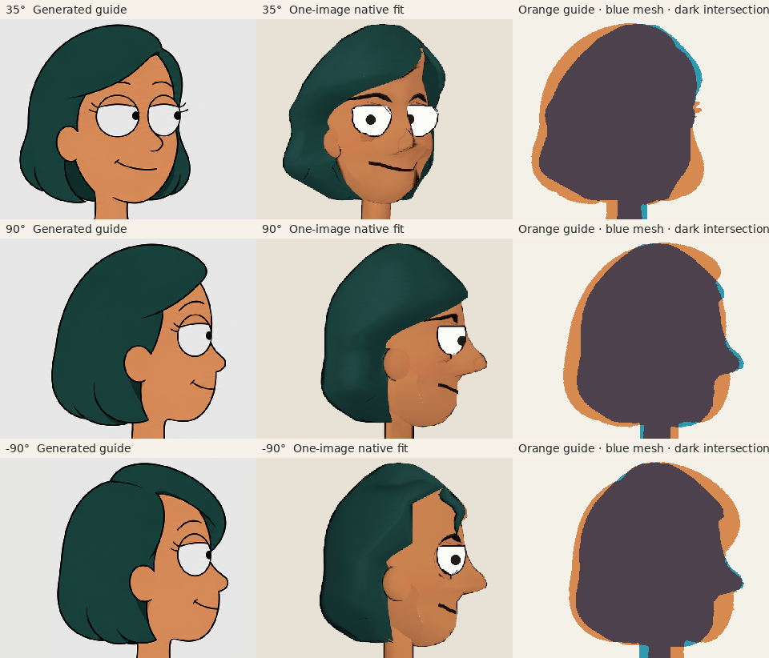

For a separate turn sheet, pass `--turn-guide GUIDE.webp` to `review-avatar-release.py` during native capture. Put the 35° head in the left half and the right-facing profile in the right half. The review binds the guide, native profile and comparison images to the candidate. A model reviewer receives the turns, both hand close-ups, crouch and six walk frames for each rendering backend. The preview review page exposes the same recorded turns for a human decision.

| Portrait input | Previous full-body silhouette IoU | Current IoU |
| -------------- | --------------------------------: | ----------: |
| Rowan          |                            0.6227 |      0.8182 |
| Poe            |                            0.6643 |      0.7989 |
| Reed           |                            0.7981 |      0.8193 |
| Indigo         |                            0.8012 |      0.8503 |

The Rick-family fitter can trace a fringe from crown pigment connected to the scalp. It records up to 16 corners in head coordinates and places them on the existing head mesh. The cap and cheek meet at that seam in every view. A second trace reads eyebrow ink below the fringe. On eye-aligned native portraits, the overlap of the dyed crown around the forehead improved from 0.705 to 0.768 for Moss, 0.817 to 0.861 for Rowan and 0.782 to 0.841 for Poe. The outer tufts and Poe’s forehead curl still differ from the drawings.

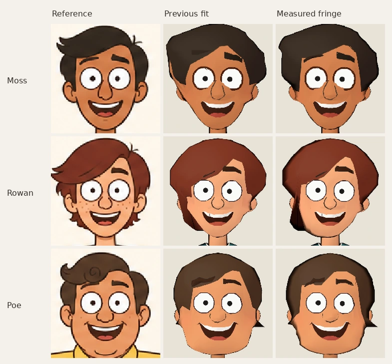

When a drawing has an exposed ear, the fitter measures its painted rim and any interior creases surrounded by skin. Sixteen radial samples describe the edge. The native mesh closes behind each lobe and joins the temple at the ear depth supplied by the family. A blank or occluded pair keeps the family default. In a fixed eye-registered window, frontal ear-skin overlap on WebGL2 rose from 0.535 to 0.632 for Moss, 0.456 to 0.532 for Rowan, and 0.368 to 0.652 for Poe. The native profiles below show how the attachment turns. The supplied drawings show only the front.

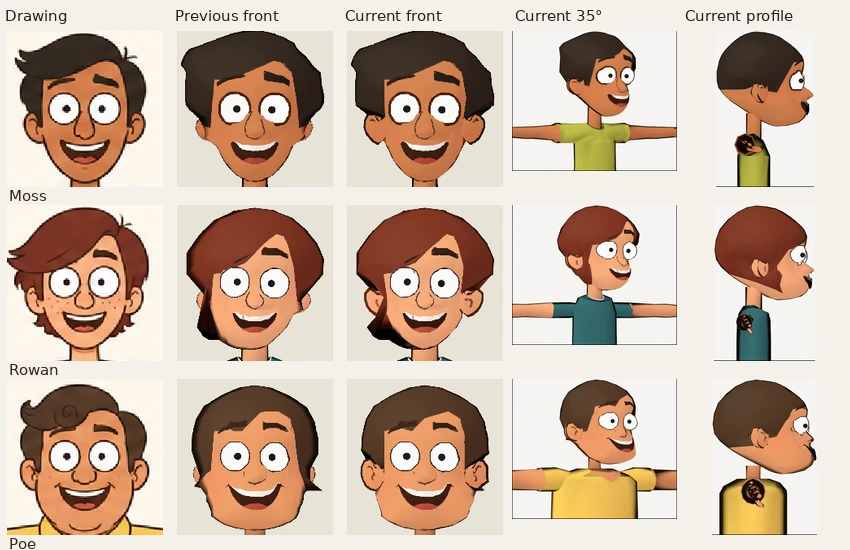

The forearm diagnostic samples corresponding columns at 24.5–32.6% of standing height on either side of the body axis. At a height of 384 pixels, Moss’s native forearms had a median thickness of 12 pixels. The source mask measured 16 pixels including the paper halo and 12–13 pixels at three paper tolerances. Lark measured 12 pixels in the native frame and 13 in the source after trimming. The published silhouette gate uses the original mask.

The casual adult Rick-family body uses trouser, arm and shoe proportions measured on Nia Bell, Nori Quill and Mara Venn, with cuff taper from Rick’s OBJ. The fitter applies this body when it can see a sleeve and a bare arm in an adult portrait. Full drawings trace the ink around the leather, exposed ankle or sock, and sole. These surfaces share closed edges at both detail levels. An inked fold across a sleeve and a split between two shirt panels can supply a rolled cuff and front hem. Lark’s purple shirt contains both. Moss’s T-shirt contains neither. Sunshine portraits measure the jersey below the sleeve against the orb diameter. The shader and rig move the shoulder socket and sleeve together. The full-body Sunshine correction locates the orb from the painted visor and fits the individual rays before adjusting head proportions. The jersey carries each forearm and wrist with its shoulder, preserving their measured thickness through collar and waist changes. Together these changes raised Solvi’s full-body silhouette IoU from 0.7729 to 0.8207 and Mora’s from 0.7595 to 0.8428. Both still miss the body outline. On a custom jersey, the fitter traces the primary emblem and up to three separate strokes in the same ink. Solvi’s first draw includes the blue canopy and both waves. Her corrected graphic scored 0.858 agreement for shape, placement and color. Mora’s peach badge reached 0.703. Both avatars still missed the overall likeness gates.

A Sunshine portrait with two visible bare forearms can supply its own sleeve pattern. The fitter measures the shoulder line, arm diameter, cuff tilt, bands and exposed chest, and traces separate ink shapes on the jersey. Reed has one yellow band, and Indigo has two dark bands and a small second chest emblem. Their legs and shoes still come from the family default. The portrait check now compares the visible shirt and arms in the orb’s coordinate system as well as checking the face. A front-facing study with enough visible cloth needs at least 0.90 silhouette overlap and mean absolute RGB error at most 28 in this region.

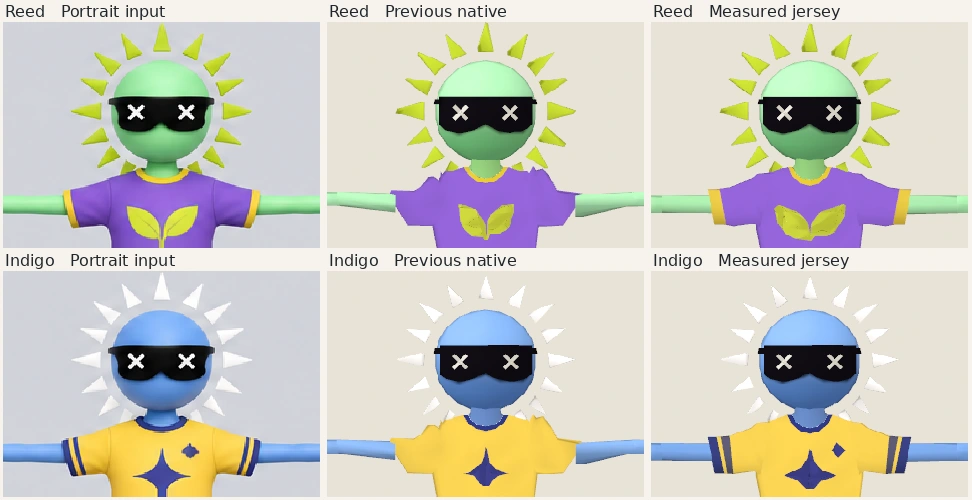

A short bob and its face share one fitted scalp and jaw. The recipe stores a single pair of orbital contours. Eye spacing, size, pigment and gaze use the same household controls after an outfit or stature change. Lark’s swept bob covers her left brow, and her right brow follows the drawn ink. The mapper excludes narrow jaw ink when estimating the end of a dark haircut. The Sunshine fitter can recover the orb from two skin arcs when a photographic halo joins the rays to the head in the foreground mask. A visible throat and crew binding have separate measurements. The collar and chest share ordered rings around the scoop through the front and back.

The eight recipe files total 82,256 bytes of JSON. Individually gzipped, they range from 1,596 to 3,858 bytes and total 18,954 bytes, excluding the shared engine. The fitter follows the background opening between the trouser legs up to the fork. The thigh and shin panels share one weighted ring, a continuous fabric coordinate and baked paint at the knee. The same ring survives crowd simplification. The benchmark measures the height of the opening directly on each native render as a fraction of standing height.

| Trouser opening from crown | Drawing | Previous WebGL2 | Current WebGL2 |
| -------------------------- | ------: | --------------: | -------------: |
| Moss                       |  0.5558 |          0.5820 |         0.5672 |
| Lark                       |  0.5560 |          0.6076 |         0.5796 |

In the trouser study, Moss’s silhouette overlap improved from 0.8923 to 0.8938 and Lark’s from 0.8745 to 0.8795. Those meshes used 3,588 and 3,719 triangles. Color error rose from 28.02 to 28.04 for Moss and from 32.15 to 32.52 for Lark.

In a Rick-family T-pose, a line of ink can separate touching fingers even when the background never shows between them. The fitter measures each palm from wrist to knuckles, then follows each visible finger to its tip. When three long fingers appear in profile, the little finger sits behind the ring finger with its own joints. The native mesh uses the benchmark hand depth and blends the wrist into the forearm. Open a fitted study with `?focus=hand` or select **Inspect hand**. Equip the microphone and switch hands to inspect either grip.

| Fitted hands, native WebGL2 | Hand silhouette IoU, previous → current | Hand RGB error, previous → current | Whole-body silhouette IoU, previous → current | Current full-detail triangles |
| --------------------------- | --------------------------------------: | ---------------------------------: | --------------------------------------------: | ----------------------------: |
| Moss                        |                         0.7971 → 0.8802 |                      38.67 → 31.09 |                               0.8938 → 0.8895 |                         3,829 |
| Lark                        |                         0.7022 → 0.8775 |                      59.17 → 35.88 |                               0.8795 → 0.8774 |                         3,936 |

The hand comparison registers both hands to the drawing’s body height and torso axis. Overall color error also fell, to 26.80 on Moss and 31.02 on Lark. Both whole-body outlines still miss the release threshold.

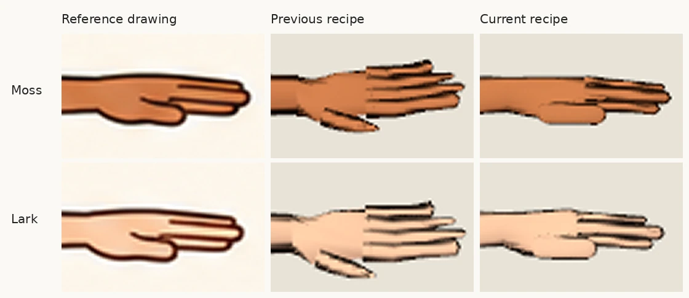

The frozen drawings have informed fitter changes. Their results measure calibration on these eight inputs. The foreground comparison still counts some gray paper between Solvi’s rays as solid. With fitted necks and bindings, Solvi and Mora scored 0.8051 and 0.8345 for silhouette, down from 0.8207 and 0.8428. Both scored lower color error. The sleeves, shorts and shoes still differ visibly from the drawings. The original acceptance thresholds apply, and promotion still requires independent visual evidence.

The Sunshine family measures a shorts pattern from fabric on both thighs and from the background visible between them. A shadow can make that opening appear too low in a binary foreground mask. The recipe records the fork height relative to the waistband and the outer hem width relative to the waist. The same leg panels supply the front, back and crouch. Their baked cloth shading follows the new cut. The archive records both measurements from the drawing and from each native backend.

| Shorts fit                                 | Drawing | Previous WebGL2 | Current WebGL2 |
| ------------------------------------------ | ------: | --------------: | -------------: |
| Solvi, rise as a fraction of shorts length |   0.458 |           0.489 |          0.473 |
| Mora, rise as a fraction of shorts length  |   0.452 |           0.505 |          0.484 |
| Solvi, hem-to-waist width                  |   1.065 |           0.960 |          1.061 |
| Mora, hem-to-waist width                   |   1.078 |           0.939 |          1.081 |

On a full T-pose the Sunshine fitter measures the slant, upper and lower edges, and colored bands of both sleeves. It uses five stations from shoulder to cuff. The measured elbow and exposed upper arm determine how much skin to show at the opening. Each color band wraps the same arm and shares its rig. In a crouch the hidden skin ends inside the arm-weighted portion of the cuff. The stock Sunshine recipe retains its VRM-derived jersey.

| WebGL2 registered sleeve region | Previous silhouette IoU | Current silhouette IoU | Previous cuff RGB error | Current cuff RGB error |
| ------------------------------- | ----------------------: | ---------------------: | ----------------------: | ---------------------: |
| Solvi                           |                  0.7266 |                 0.8900 |                  110.56 |                  31.09 |
| Mora                            |                  0.7160 |                 0.8944 |                   38.67 |                  18.57 |

Both full-body silhouettes improved. Solvi went from 0.8112 to 0.8303 and Mora from 0.8413 to 0.8598. The sleeve study used 1,805 and 1,798 triangles respectively. Solvi’s overall registered RGB error rose from 24.38 to 25.13, while Mora’s fell from 21.89 to 21.44. Both still miss the full-body likeness gate.

The custom orb now shares vertices across the center of the forehead before mesh simplification. Skin grain uses coordinates on the orb and the same material on both sides. The full and crowd meshes both form a closed surface. In frontal captures, the largest single-pixel luminance step on bare skin fell from 4.26 to 0.79 on Solvi and from 7.53 to 1.00 on Mora on both backends. The same region measured 1.60 and 2.19 in their drawings, on a 0–255 luminance scale.

The Sunshine fitter measures the light on both sides of the forehead and chin. Three coefficients describe the side, vertical and forward components in log luminance. The native builder bakes them into the existing sphere vertices. It continues the frontal light into a soft fill at the rear. A partial observation or a strongly localized painted highlight keeps the family lighting. The visor renderer follows the outer wings, bridge and hem with a curved closed front and a strap around the temples. It samples separate pigments for the upper lens, lower lens and eye marks.

| Sunshine drawing | Lens overlap, previous → fitted | Forehead color error, previous → fitted |
| ---------------- | ------------------------------: | --------------------------------------: |
| Solvi            |                   0.925 → 0.951 |                             7.38 → 5.95 |
| Mora             |                   0.912 → 0.952 |                            11.50 → 4.17 |
| Reed             |                   0.892 → 0.942 |                            16.84 → 4.62 |
| Indigo           |                   0.905 → 0.931 |                            13.97 → 5.81 |

These WebGL2 measurements register the drawn and native spheres by their two painted arcs. The lens measure uses the connected dark contour and the color measure averages absolute sRGB error on exposed forehead pixels. The release receipt contains the WebGPU measurements from the same native poses.

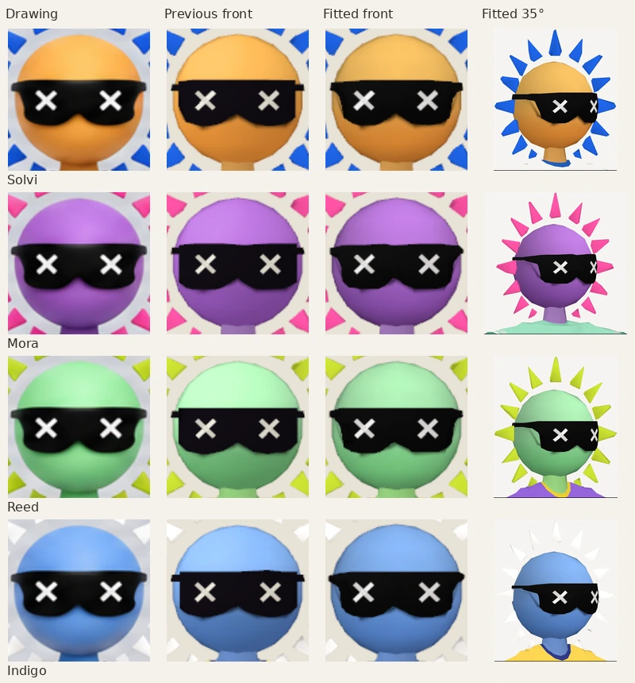

With both legs visible in a Sunshine drawing, the fitter looks for matching light sports socks and contrasting low shoes. It reads stripe positions, dyes, the height and five widths of each shoe, and repeated transverse marks across both tongues. A plain shoe can have zero laces. These measurements are fractions of the visible leg and foot spacing. The rig supplies the unseen depth from ankle to toe. The shoe carries the sole and lace pigment on one continuous surface. The sock bends into the ankle, and the exposed skin crosses the knee on rings weighted to both the thigh and shin.

| WebGL2, from sock cuff to floor | Previous silhouette IoU | Fitted silhouette IoU | Previous RGB error | Fitted RGB error |
| ------------------------------- | ----------------------: | --------------------: | -----------------: | ---------------: |
| Solvi                           |                  0.7746 |                0.7925 |              41.80 |            30.52 |
| Mora                            |                  0.7923 |                0.8231 |              42.60 |            28.40 |

The reference and candidate use the same standing-height registration. The evaluator recovered both sock bands and all three lace marks from each native front on WebGPU and WebGL2. Solvi’s whole-body silhouette IoU went from 0.8303 to 0.8323, and Mora’s from 0.8598 to 0.8640. Their overall RGB error fell to 23.88 and 19.79. The full-detail meshes contain 2,530 triangles for Solvi and 2,525 for Mora. Both drawings still miss the full-body release checks.

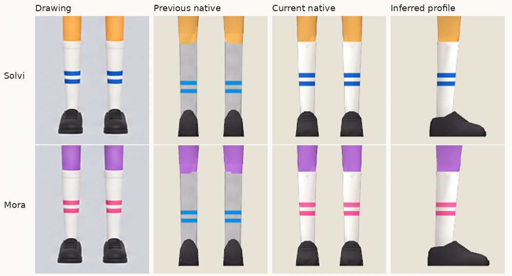

The Sunshine fitter traces the painted boundary of each ray with up to six points. It follows shaded pigment beside the collar, detects pale rays against darker paper, and uses the shared distance of the ray bases from the orb to exclude sleeve accents. All four Sunshine inputs yielded 15 rays. The separate Halo reference retained its 11. Each measured visor can also store the width and strength of the contact shadow underneath its lower edge. The shadow uses the closed skull’s existing mesh and material. It moves with the face and fades at the temples.

| Sunshine head, WebGL2 | Previous ray pigment IoU | Current ray pigment IoU | Drawn brightness beneath visor | Rendered brightness beneath visor | Full-body triangles |
| --------------------- | -----------------------: | ----------------------: | -----------------------------: | --------------------------------: | ------------------: |
| Solvi                 |                   0.6523 |                  0.8058 |                          107.9 |                             104.1 |               2,735 |
| Mora                  |                   0.7044 |                  0.8349 |                           66.6 |                              67.6 |               2,662 |

The two small rays beside each collar had zero pixel overlap in the previous render. Their overlap rose to 0.6060 on Solvi and 0.6339 on Mora. Whole-body silhouette overlap reached 0.8597 and 0.8685. Indigo’s visible portrait scored 0.8610 and its withheld body scored 0.8012.

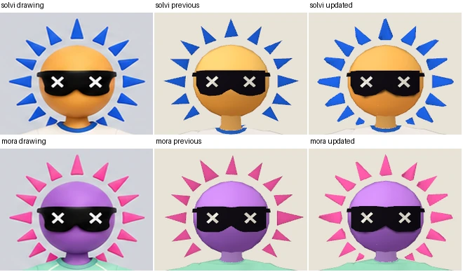

The source paper changes shade near the rays. The crown diagnostic holds the camera registration fixed and samples paper on both sides of the head. It removes only exterior-connected pixels within 12, 19 or 27 sRGB levels of that local paper. An enclosed highlight keeps its original pixels. At the narrowest tolerance, Solvi’s drawing compared with itself scores 0.814 overlap and Mora’s scores 0.851. Both native images score 1.000 against themselves. Comparing the visible painted crown in the native render and drawing gives 0.913 for Solvi and 0.918 for Mora. These figures apply to the frontal crown window. The frozen full-body, head, color, animation and independent review gates still determine promotion.

The one allowed correction registers a jersey graphic to its first native render. It compares the source and rendered ink on the same chest frame, corrects its scale and position, follows detached strokes of the same pigment, and adjusts the dye for the observed lighting. A visible gap in a stroke can be represented by two adjoining fills on the curved cloth. The chest graphic remains part of the single skinned mesh.

| Shirt graphic      | Previous agreement | After correction | Full-body triangles |
| ------------------ | -----------------: | ---------------: | ------------------: |
| Solvi’s wave       |             0.5182 |           0.9467 |               2,735 |
| Mora’s chest badge |             0.0000 |           0.8338 |               2,662 |

Both graphics passed the 0.65 shirt check. The remaining misses include head and whole-body silhouettes for both avatars and Mora’s body edges. Solvi’s overall RGB error fell from 20.99 to 20.40, and Mora’s fell from 20.78 to 20.54. The native tests also captured each shirt during a walk, a crouch and an item grip.

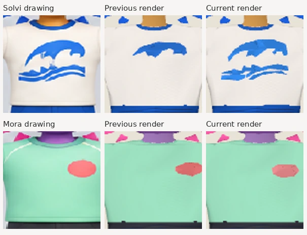

Moss’s sneaker and Lark’s flat now share a closed shoe built from cross sections through the ankle, instep, heel and toe. The fitter reads the top opening, contrasting sole, underside of the arch and repeated lace strokes from the drawing. On the full-body WebGL2 view, silhouette overlap rose from 0.8895 to 0.8912 for Moss and from 0.8774 to 0.8807 for Lark. The two full meshes have 3,977 and 3,910 triangles respectively. Both still miss the 0.90 full-body threshold.

On an exposed Sunshine arm, the full drawing supplies wrist thickness, fingertip thickness, the position and dye of a wristband, and the change in brightness around the forearm. The open palm joins the forearm with blended joint weights. Each of the five fingers uses the rounded pad construction from Rick and curls around the existing item socket. A band drawn on one wrist appears on that side. All of the shading travels with the skinned mesh as vertex color.

| WebGL2 hand measurement                                   | Solvi drawing | Solvi render | Mora drawing | Mora render |
| --------------------------------------------------------- | ------------: | -----------: | -----------: | ----------: |
| Wrist radius, % of standing height                        |          1.26 |         1.31 |         1.31 |        1.47 |
| Band center, % of chest-to-fingertip span                 |         79.41 |        79.71 |        79.52 |       79.62 |
| Underside brightness relative to center, linear luminance |          0.55 |         0.64 |         0.46 |        0.52 |

Solvi and Mora use about 3,200 triangles apiece at full detail. The hand study scored 0.8611 and 0.8700 for whole-body silhouette, respectively. The 0.90 threshold still holds for both.

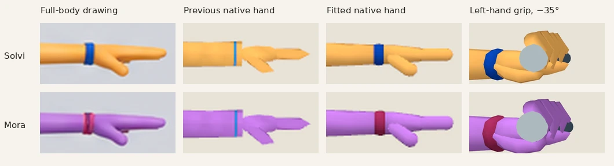

The Rick-family fitter measures the shoulder where dyed fabric reaches both sleeves. It joins a single shoulder panel to the chest, collar and sleeve rings, blending their joint weights. A crew neck retains its rounded binding. A button-front shirt follows the visible skin down to the point of the opening and, when the folds are legible, turns its two collar points back onto the chest. The single correction can move each side seam independently. These measurements require a sleeved T-pose.

| WebGL2 measurement     | Moss, previous → fitted | Lark, previous → fitted |
| ---------------------- | ----------------------: | ----------------------: |
| Torso fabric overlap   |         0.9279 → 0.9799 |         0.8713 → 0.9103 |
| Exposed throat overlap |         0.6806 → 0.6938 |         0.4038 → 0.7214 |
| Whole-body silhouette  |         0.8912 → 0.8871 |         0.8807 → 0.8816 |
| Full-detail triangles  |           3,977 → 3,890 |           3,910 → 3,743 |

The cloth and skin measurements use fixed windows registered to standing height. They supplement the original full-body gates. Both shirts fit the drawn torso more closely and both characters still miss the silhouette threshold.

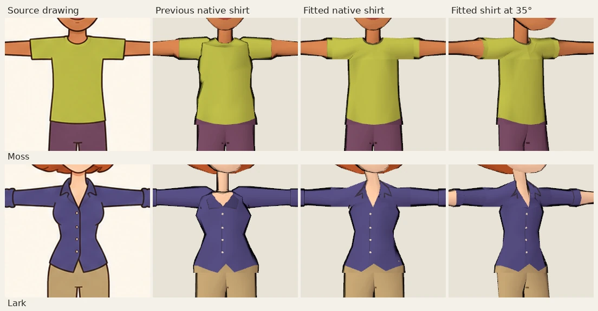

Finch was an additional GPT Image drawing generated after fitting Moss and Lark. The untouched fitter chose an eye white as hair, extended the head outline across the shoulders, and missed the polo and both open hands. Both allowed attempts missed. These results remain separate from the frozen eight.

After that trial, the fitter checks whether a hair swatch lands inside an eye, follows the jaw to the narrower neck above a collar, and distinguishes the wrist from the gap after a raised thumb. A short polo can now use two dark fasteners beside a continuous seam that ends on the upper chest. The replay passed the visible checks in one draw at 3,650 triangles. Whole-body silhouette overlap moved from 0.9005 to 0.9444, head overlap from 0.7277 to 0.9284, and the native hands retain five articulated fingers each. The cowlick, ear outlines and collar points still differ from the drawing. The fresh and calibrated local trials took 37.57 and 51.57 seconds respectively and made zero model calls. The generator supplied neither an exact model version nor a charge. Finch is available for independent review at `/preview/studies/finch/review`. [Trial receipts](../frontend/scripts/avatar_authoring/targets/holdout-v1/followup-studies.json)

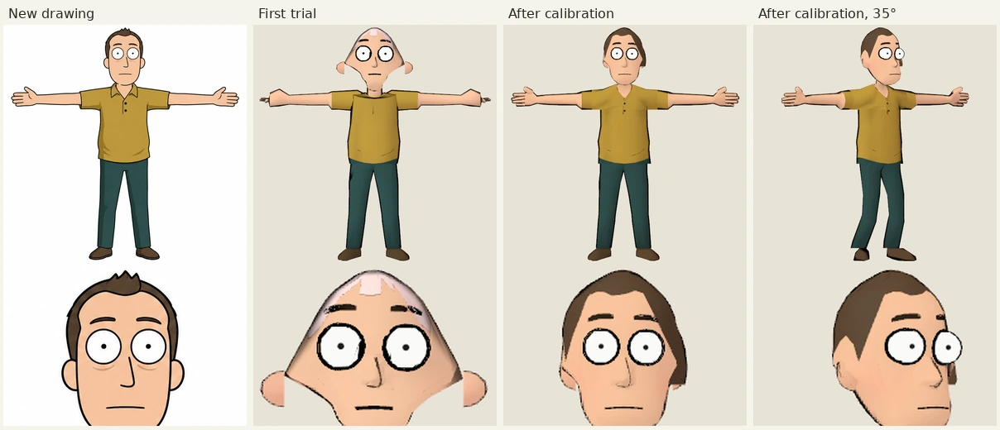

Clove is a second follow-up study. The fitter received a 352 × 232 crop of a frozen GPT Image drawing. Its first attempt stopped at family identification in 0.06 seconds, before it produced an avatar. The plum face and black visor had merged. The calibrated fitter locates the two enclosed eye marks, measures bare temples, and can scale the entire orb in depth and height when both the torso width and shoulder height support a larger head. Clove’s first calibrated draw passed the visible checks in 52.83 seconds at 1,924 triangles. It scored 0.8666 for head overlap, 0.9009 for visible clothing and 0.7311 against the withheld whole body. The shorts, sock bands and shoes differ from the drawing. The fitter made zero model calls. GPT Image returned the drawing in 29.3 seconds and supplied no model version or charge. Independent review is pending. [Clove trial receipts](../frontend/scripts/avatar_authoring/targets/holdout-v1/followup-studies.json)

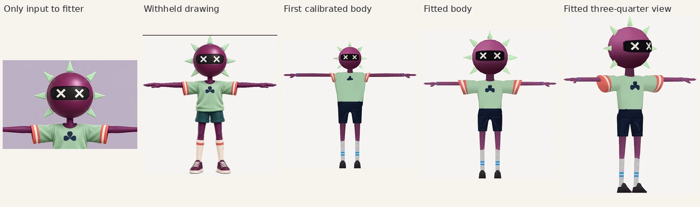

Tavi tested transfer to another Rick-family portrait. Both pupils touch the upper lid. The blind run rejected the crop during family identification in 0.05 seconds. The calibrated fitter measures the dark indentation in each eye white, the eyebrow above the orbital arch and the paint around a closed lip seam. It also bounds the hair at the observed nape. On replay, the first native portrait passed its visible thresholds with 0.8627 head overlap, 27.41 mean color error and 0.8898 ink agreement. It took 11.21 seconds and produced 3,113 triangles. Measuring the swept crown on the same crop increased visible head overlap to 0.8915 at 3,134 triangles in 19.50 seconds. The earrings are missing. Whole-body overlap fell from 0.7215 to 0.7163 against the withheld drawing. The fitter made zero model calls. GPT Image produced the original drawing in 26.57 seconds and supplied no exact model version or charge. Both backend captures are available at `/preview/studies/tavi/review`. [Tavi trial receipts](../frontend/scripts/avatar_authoring/targets/holdout-v1/followup-studies.json)

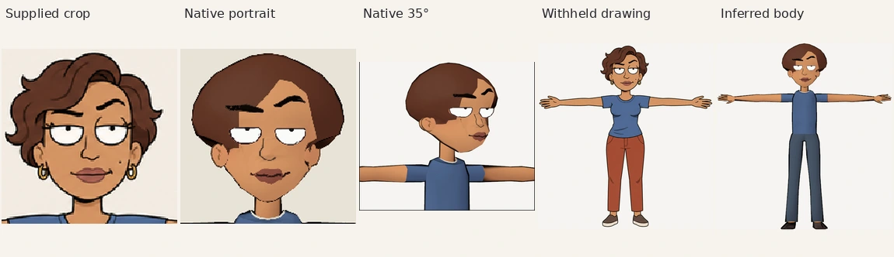

Brin is a fresh full-body Sunshine drawing with a dark jersey, copper shorts, light-soled sneakers and cream eye marks. The blind run stopped at family recognition in 0.85 seconds. After calibration, the fitter recognized the paired tinted marks and measured the jersey hem by following the fabric up from each bare leg. It recovered the rubber sole, three pale laces and one sock stripe on each leg. When both shin centers diverge from the shorts hem to the ankles, the rig uses that spacing in its rest pose and fits the shoes to the toe spacing. Both pictured hands have a visible thumb and four separated shafts. The author measures their roots, tips and thickness and places them on the existing hand and finger bones. The held-item socket follows the measured palm plane. The native review traces each fingertip on both hands and checks its projected position and diameter.

The first rendered fit scored 0.7530 whole-body silhouette overlap. Colored shorts, footwear and leg stance brought it to 0.8384. Measuring the open hands brought it to 0.8488. Measuring three jersey widths brought it to 0.8684 at 2,606 triangles. The shirt still lacks its gold neckline and hem. Brin still misses the full-body likeness gate. The final local fit took 67.1 seconds across two native passes with zero model calls. GPT Image returned the target in 35.105 seconds and supplied no exact model version or charge. Independent review is pending. [Brin trial receipts](../frontend/scripts/avatar_authoring/targets/holdout-v1/followup-studies.json)

The viewer-left and viewer-right hand windows for Brin, registered at the same standing height, improved from 0.7033 and 0.6932 overlap to 0.8113 and 0.8245. All ten finger shafts are traceable on both native backends. The same jersey side-seam pattern improved Solvi’s whole-body overlap from 0.8618 to 0.8745 and Mora’s from 0.8711 to 0.8790. Both still miss the 0.90 threshold. The portrait and full-body fitters sample the same native jersey pattern. [Native views, walk, crouch and grips](https://oncyber-git-preview-procedural-avatar-rick-oncyber.vercel.app/preview/studies/brin/review)

The shorts fitter now looks for the cloth-to-thigh transition on both legs, then measures the visible opening between the inside hems. The shared inseam widens from its sewn fork to that opening. Solvi's drawing measures 11.0% of garment width between the hems and WebGL2 measures 9.4%. Mora measures 9.6% in the drawing and 9.2% in the render. Brin's copper fabric transitions to skin near source row 834. Her updated full-body overlap is 0.8668, down from 0.8684. The calibrated fit took 49.35 seconds.

To fit a registered follow-up, capture both native backends and archive the exact selected recipe, run the following command with a fresh output directory and a unique trial name. A repeated invocation resumes the same output. The command records a visual miss and returns a failing status. It preserves the original blind trial and its source image.

```sh
python frontend/scripts/benchmark-avatar-holdout.py /tmp/brin-study --case brin --record-followup kit-replay
```

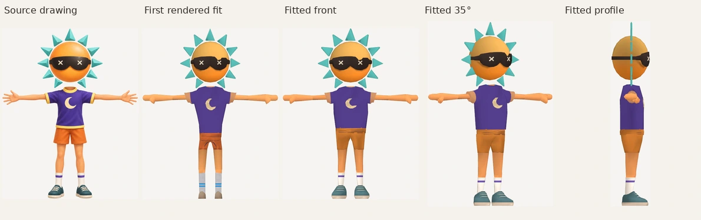

Solvi’s illustrated wave has four separate blue areas. The previous shirt check scored 0.8232 while entirely missing one of those areas. The fitter now follows the crest and all three lower areas from the source pigment, clips them to the same skinned fabric, and compares each area in the native render. The first pass recovered 76–91% of every area. After one correction it recovered 81–95% on WebGL2 and 71–94% on WebGPU, and body-edge agreement rose from 0.622 to 0.718. The final mesh has 3,266 triangles. The frontal whole-body and head thresholds still fail. [Solvi review](https://oncyber-git-preview-procedural-avatar-rick-oncyber.vercel.app/preview/studies/solvi/review)

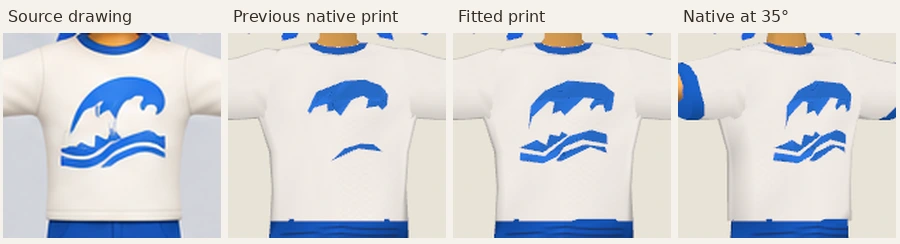

Open `/preview/studies/rowan` on the branch preview to compare the reference and candidate in the native viewer. Each study supports rotation, portraits, walking, crouching and the right-hand attachment. The eight study recipes stay outside the installed avatar catalogue. **Review recorded views and motion** opens the exact study’s WebGL2 and WebGPU contact sheets and walk animations. The grip check reads the microphone’s actual wrist attachment and measures the rotation of each of the five fingertip joints when equipping it. It exercises each hand and checks that releasing the item removes it and its socket. The review sheet includes both grips. The review page includes the supplied portrait for cropped inputs. It downloads a human reviewer’s pass or miss for each criterion, together with the reference and evidence digests. Import the downloaded assessment using `review-avatar-release.py CANDIDATE REFERENCE APPROVAL --decision REVIEW.json`. A documented miss stays in the study. Promotion requires a passing decision and passing native checks.

Open `/preview/crowd?shadows=1` to animate 100 variations of those eight recipes. Select **Shadows only** to inspect each cast silhouette. In headless Chromium with SwiftShader, both WebGPU and WebGL2 submitted one avatar draw for color and one for the directional shadow map. Both screenshots contained figures or shadows in all 100 projected positions. The renderer submitted four total draws and 433,581 triangles per frame with the receiver and shadows enabled. Load-to-ready took 4.50 seconds on WebGPU and 5.32 seconds on WebGL2 in this run.

Use the following commands after the eight-case benchmark and native release captures. The crowd test verifies the digest of the eight exported recipes. The last command verifies the capture hashes for all eight candidates on both backends before recording the results used by the branch preview. A reviewer can record the reason a candidate failed against these captures. Promotion requires both the original numerical thresholds and an independent passing decision.

```sh
python frontend/scripts/benchmark-avatar-holdout.py OUTPUT --export-candidates frontend/scripts/avatar_authoring/targets/holdout-v1/candidates
python frontend/scripts/verify-cartoon-crowd.py OUTPUT/batch --preview --shadows
python frontend/scripts/benchmark-avatar-holdout.py OUTPUT --record-preview RUN_ID --crowd-evidence OUTPUT/batch/crowd.json --benchmarks BENCHMARK_DIR
```

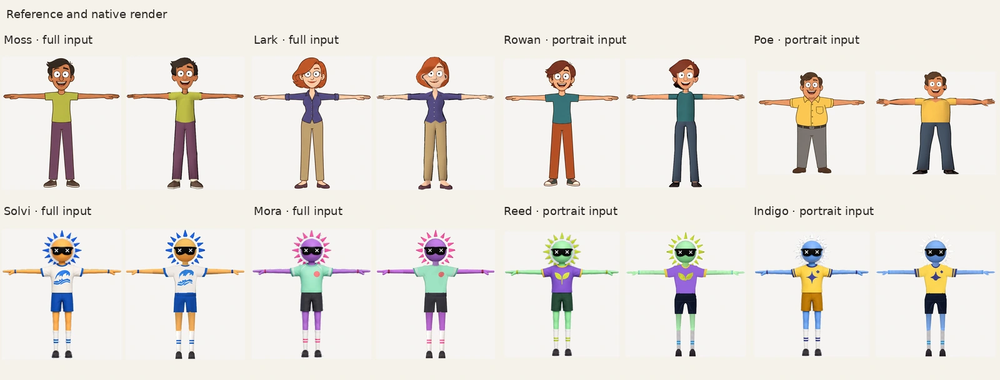

## Draw a recipe from a T-pose

Use a single front-facing, upright cartoon humanoid with both arms extended and the entire figure visible. The image can have a transparent background or a uniform contrasting one. The authoring tools use Python 3.10+, Pillow, NumPy, SciPy, ContourPy, jsonschema, Playwright and Chromium. Start the local frontend before running the drawing tool.

```sh
python frontend/scripts/author-cartoon.py character.png /tmp/avatar-drawings \
  --endpoint "$AVATAR_RESPONSES_URL" --model gpt-6.2-astra --rounds 2
```

To make a first draft locally from just the image, run the following command. The output directory contains the measured observation, recipe and rendered comparisons.

```sh
python frontend/scripts/author-cartoon.py character.png /tmp/avatar-drawings --auto --name "My character"
```

When the tool can measure the drawing it provides a proposal at `cartoon://input/draft`. Use `draw_from_draft` with `base_pass: 0` to edit it. If the reference needs manually placed landmarks, start with a full `draw_cartoon` observation. After either kind of drawing, use the returned pass number and edit only the fields that need to change, such as `parts.feet`, `parts.palmRoll` or `details.noseProjection`.

Version 2 adds spectacle shape, nose width and projection, and the fall of a ponytail. The compiler can replay version 1 measurements. It identifies landmarks, samples of skin and fabric, the cut of the hair and clothes, and details outside the drawing vocabulary. The compiler samples the actual colors and traces the eye whites, brows, hair opening, jaw, shirt, sleeves, trousers and shoes. A small JSON file stores the result. Its sections become solid surfaces on the shared humanoid rig at load time.

Each pass runs the recipe in Oncyber and captures four body angles, eight portrait angles around the head and a twelve-frame walk with a held microphone. The revision receives the original image, comparison sheet, three-quarter view, portrait turns, prior observation and measurements. The tool measures front silhouette, visible facial skin, regional overlap, colors, facial edges and gaze. It excludes candidates that exceed the triangle budget or leave sizable detached components in the native frontal silhouette. Hair obscuring the nose in profile reduces the score. When both source pupils are readable, a missing pupil, a misplaced opening or a gaze error greater than 23% of the opening width or height sends the candidate back for revision. When the guide cannot resolve both pupils, the report flags the eyes for visual review. A front image leaves the back, the underside of the hair and much of the facial depth to inference. The report records the features the observer marked for review.

A Responses-compatible endpoint accepts the URL and the optional `AVATAR_MODEL_API_KEY` environment variable. For another provider, pass `--adapter /path/to/executable`. It reads a single JSON request on stdin with `model`, `prompt`, `tools` and local image paths, and writes a JSON response with `model`, `request_id` and the observation in `arguments`. The provider’s reported model must match the request. A saved observation can be replayed offline.

Use `--openrouter` for the OpenRouter API. It reads `OPENROUTER_API_KEY` and resolves the requested model against the provider catalog before sending the image. If the catalog has no exact match, the run records the error. For example:

```sh
python frontend/scripts/author-cartoon.py character.png /tmp/avatar-drawings \
  --openrouter --model gpt-6.2-astra
```

When the local measurements produce a render, the hosted model sees the source, the ruler guide, the rendered body comparison, face comparison and full head turnaround on its first call. It can submit edits against pass zero or keep the preview with an empty edit list. An unchanged drawing reuses the native captures, rechecks the acceptance criteria and can finish in one model call. A preview by itself never selects a recipe. The local MCP client can inspect the same body and face sheets at `cartoon://input/preview/body` and `cartoon://input/preview/face`, and the eight-view turn at `cartoon://input/preview/turn`.

```sh
python frontend/scripts/author-cartoon.py character.png /tmp/avatar-drawings \
  --observations observation.json --install my-character --release /tmp/avatar-review
```

A model client with local MCP support can read the image and call the drawing tool directly. Install Python’s `mcp` 1.x package in the authoring environment and configure the following as the client’s stdio command. Use absolute paths for the script, image and study directory when the client launches elsewhere.

```sh
python frontend/scripts/author-cartoon.py character.png /tmp/avatar-drawings --mcp
```

The server exposes the source T-pose at `cartoon://input/source` and the calibrated image and face enlargement at `cartoon://input/guide`. A call to `draw_cartoon` takes the model’s observations. The response contains the native comparison and head turns, the scores, the triangle budget and the best qualifying recipe so far. The client can revise its observations using those images. The guide suggests eye centers in the original 0–1000 coordinate system when it can identify a pair. The compiler measures the pupil even when its ink touches the lid. It also traces mouth pigment, the neckline, shirt stripes, sleeve openings and unequal limb lengths. For cropped ears visible through a bob or waves, it measures the exposed arc and opens the hair around it. The hosted API and stdio transports use the same fitter and native renderer.

Each run saves its source hash, attempt receipts, scores and selected recipe. Open a recipe file in `/dev/cartoon-author`. An installed slug also works at `/dev/cartoon-author?character=my-character` and at the native model URL `/models/procedural/drawn-my-character`. Oncyber fetches its recipe when selected. The installed example, `mara-venn`, occupies 4,742 bytes as compact JSON. Its test used a recorded observation and reached 92.1% front silhouette overlap. A second T-pose with unequal eyes and an asymmetric stance, Hugo Silt, reached 93.3% with 3,908 triangles. Its local MCP integration test read both image resources, rejected an invalid observation, drew the avatar in Oncyber and returned the selected recipe and both review images. The client replayed recorded observations. A live model call was outside that test.

To test an installed character in a mixed crowd, open `/dev/procedural-crowd?cast=cartoon&guest=mara-venn`. Repeat the `guest` parameter for additional installed slugs. The remaining slots use different seeded cast recipes. The page reports avatar draw calls separately from the final color pass and shows the submitted triangle count for the current mix.

### Which parts of the system transfer to another character

Rick’s classic head uses section contours measured on the OBJ. Sunshine’s skull is an oval measured on the VRM, with separate paint and features. Both establish that compact native geometry can reproduce a known character. The cast generator also borrows measured limb and eye proportions. Its independently fitted fringe, forehead, ear and eyelid surfaces still give inconsistent results on a new face.

The new `roundedProfile` shape uses closed horizontal sections. Each station sets the width, depth, depth at maximum width, and roundness. The builder retains silhouette bends during mesh reduction. A feature attached to the named shape can sample the front or rear of its generated surface. The same shape recipe works with the existing rig and crowd renderer.

The skull study renders each benchmark’s bare skull into orthographic masks, fits the front, right profile and 35° contours, then compiles the recipe through the native builder and measures its retained triangles. Views at 65°, 135° and two pitched angles test the result. With 16 stations and 24 sides before reduction, Rick’s skull took 350 triangles and had at least 95.7% silhouette overlap across those four views. Sunshine’s took 424 triangles and had at least 97.3%. Transferring only the other character’s depth onto a frontal outline gave 85.5% and 84.2% in profile, respectively. These comparisons cover the fitted skulls. Hair, eyes, expression and likeness require their own full-head comparisons.

```sh
python frontend/scripts/assess-avatar-heads.py /tmp/head-study
python frontend/scripts/fit-rounded-part.py /tmp/head-study/sunshine-front-mask.png \
  /tmp/head-study/sunshine-side-mask.png /tmp/head-study/skull.json \
  --quarter /tmp/head-study/sunshine-oblique-mask.png --height 122.4 --center 350 106 -5
```

The image fitter accepts an isolated part with a contrasting background, alpha, or a binary matte. Each view needs the same horizontal orbit center and an orthographic camera. The fitter scales the vertical span in each image to the supplied height. The center and height locate the part in the target rig’s drawing coordinates. The resulting JSON can be passed as `AvatarRecipe.shapes`. A full character drawing needs a part silhouette or a proposed underlying skull before this fitter can recover the shape.

For new characters, the proposed authoring contract is a shared volumetric head, an eye and lid with a common boundary, ears attached to the cheek, and independent hair and clothing shells. The image model supplies measurements, colors and uncertain depth estimates. The renderer owns geometry, animation and attachments. A fresh character generated from a single request, with an artist-approved turn held out and no changes to the builder, is the next test of transfer.

### Fitting and checking a turned head

Tess Brindle is installed at `/dev/cartoon-author?character=tess-brindle`. Her T-pose sets the eye openings, gaze, jaw width, shirt and hairline. For a character with a swept bob, the builder joins the face and hair roots on a shared skull. The baseline skull depth comes from the fitted classic Rick model. Tess also has a side guide for the eye sockets, chin, leading locks and back of the bob. Her recipe occupies about 10 KB on disk and builds one skinned mesh within a 4,000-triangle budget.

Pass `--profile side.png` to any authoring run to supply a matching left- or right-facing portrait. Include the crown, visible eye, chin and shirt neckline on an isolated background. The fitter measures head depth relative to the neck and registers the eye and nose against the frontal landmarks. The runtime loads the resulting recipe. The portrait remains an authoring input.

The original drawing sets each pupil’s horizontal position, height and diameter. A side portrait adds the depth and outline of the visible white and the reach of the lid. The nose, cheek and chin share a continuous skin surface. The smile wraps around the cheek to the measured corner. The bob joins the skin at its fringe and rolls under the nape. From a T-pose alone, the builder fits the cranium, globe sections and pupil offset measured on Rick’s OBJ to the new character’s traced eyes, hair and jaw. The fitter removes narrow hair highlights before tracing the ears. It places a visible ear on the side of the skull and tucks the hair beneath it. A side portrait refines the ear’s depth. Where the hair covers the whole crown, the skin starts below the part.

Pass `--quarter turn.png` to compare against a right-facing 35° drawing. The review registers on both eyes so the far lock stays in frame. To use a visible far lock as a geometry measurement, supply `--profile`, `--quarter` and `--fit-quarter` together. The recipe stores the outer contour at a few heights. The fitter adjusts the far lock in depth and fits the crown between the two visible oblique tangents. The crown keeps its frontal and profile extents and stays sewn to the hairline. When both pupils are legible, the recipe also stores their horizontal positions across the two eye openings. The native avatar exposes `setGazePose(weight)` to blend from its frontal resting expression to the turned expression at any camera angle. The authoring review captures both expressions at 35° and measures them separately. A side portrait also measures both the forward reach and the height of the nose tip relative to the eye and crown. The full and crowd meshes use the same fitted corneal sections and the same native gaze control. The run receipt records which guides supplied measurements.

For a side-parted bob, the fitter traces the notch between the two lobes in the T-pose. That position and depth set the fold in the crown, the short lock over the temple and the opening over the forehead. Mirroring the source moves the part to the other side. The cut uses the same geometry pipeline with estimated depth from one image or measured depth from a profile.

Pass an optional `--opposite-profile IMAGE` to review the other side of an asymmetric cut. This drawing is used during comparison. The fitter still takes its geometry from the front and any explicitly enabled fitting guides. The original T-pose and the turn guides each supply a comparison of the visible hairline above the brows. The frontal check requests a revision when that contour drifts by more than 8% of the eye-to-crown height at the 90th percentile. The review requests a revision when the 90th-percentile contour distance on either side exceeds 14% of the eye-to-crown height. A guide with no measurable fringe skips that measure. Inferred drawings record a proposed interpretation of the hidden side. An author can set `details.fringeDepthScale` through `draw_from_draft` to adjust how far the lock projects over the forehead. Values range from 0.75 to 1.2, with one preserving the initial fit.

For a parted bob, adding `--fit-opposite-temple` enables fitting from both side portraits. The fitter traces the patch of forehead between the temple and the visible forelock, then registers its depths to the primary eye. The run receipt records which views contributed to the geometry. Add `--calibrate-turns` to try neighboring fringe and eye depths in the native renderer. Each local trial records which control changed, reruns the drawing and animation checks, and competes with the initial recipe under the same triangle budget. The calibrated run ranks qualifying recipes by their weakest supplied turn, then by the combined score.

The primary profile also measures the underside of the chin, the brow above the lid and the tangent where the cheek meets the hair. The 35-degree guide supplies both the front and rear outlines of the bob. When a side drawing shows forehead between the rear bob and the forward bang, the review follows both boundaries. It flags a missing opening across more than one fifth of the measured rows or a 90th-percentile boundary error above 14% of eye-to-crown height. Tess’s installed study fails that check at −90°. The three-quarter gaze check also reports how much of each eye opening meets a dark stroke when the original drawing has traced eye ink.

The reviewer measures background showing through a side-parted bob above the eyebrow. A new gap in a measured turn requests another pass. With a T-pose alone, the two oblique renders record unexpected gaps for visual review. When both profile drawings are supplied, `guide_outline_agreement` in `metrics.json` compares their exterior widths at the same crown-to-eye scale. It records the worst sustained difference and its height. Framing, eye heights, perspective or inconsistent drawings can cause a discrepancy. Both native profiles still have to pass their own checks.

Use `python frontend/scripts/render-avatar-obj.py rick-t-pose.zip OUTPUT --views front quarter profile other-profile other-quarter back` for six views of the same MRGB reference at one orthographic scale. Each render has a matching foreground mask.

After rendering those views, run `python frontend/scripts/compare-cartoon-turns.py OBJ_OUTPUT NATIVE_PASS --output REVIEW`. You can include a previous native pass before the new one for a side-by-side comparison. It reads the binary matte at each angle, including gaps between limbs, and fixes scale and vertical registration from the front throughout the turn. Both cameras must use the same rotation axis and orthographic T-pose. The output contains an overlay and per-view silhouette overlap scores.

To exercise distinct recipes in the native lobby batch, run `python frontend/scripts/verify-cartoon-crowd.py REVIEW frontend/public/lobby/procedural/recipes/*.json` against the running studio. It serves temporary variations of the supplied recipes to the local browser, animates 100 visible actors, and checks the number of distinct requests, backend and avatar draw calls. It saves both frames and the reported geometry and preparation times.

For a radial spiked hairstyle, the automatic draft detects distinct tips above and around the face. The recipe stores a center and an ordered frontal outline. The head builder wraps that outline using the depth rings measured on Rick’s crown. A continuous brow can span both eyes. For a visibly open mouth with distinct warm interior pigment and teeth, the recipe stores the tooth edges and tongue in vertical strips that follow the face. The source artwork supplies their colors. A front render from Rick’s OBJ can serve as a local end-to-end test of these features. His existing fitted avatar and a fresh one-image reconstruction are separate benchmarks. When both eyes are open and round, their outlines constrain globe depth regardless of hairstyle. When matching sleeves and two contrasting panels continue below the shirt, the draft selects `open-coat`. The front drawing supplies the opening, sleeve cuffs, panel widths, hem and paint. The builder wraps those edges around the torso, folds the free edges and shades the reverse of the fabric as lining. Below the waist each tail follows the adjacent thigh, with a continuous join along the centre back. Coats get an additional rear walking capture. A coat can fill the space between the thighs, so the fitter traces the trousers separately. The review compares the visible shirt, sleeves and panels with the input. The local study at `/dev/cartoon-author?character=rick-coat-study` uses only the frontal rendering of Rick’s OBJ as input.

A bob can hide the angle of the jaw in a T-pose. The builder estimates that part of the skull from the lobe and chin. With two turn guides, the fitter triangulates the visible cheek below the ear and seats a closed smile on the same curved surface. The side view supplies the depth and the shape of the smile. The oblique view locates its near corner and the hidden ear. The authoring review measures the visible cheek boundary and the distance between the drawn and rendered smile strokes in units of eye-to-crown height. It only scores strokes it can identify in the drawing.

Nose and smile ink use the existing skin material and skinned mesh. Each brush edge follows the simplified face triangles. Ink beyond the frontal drawing’s mouth endpoint appears as the cheek turns toward the viewer. When the side drawing shows a bare nose, the frontal stroke fades into its real silhouette. These treatments require a few local surface vertices and no character texture download.

The profile fitter follows connected scalp pigment down to the hem of the bob. Dark collar ink can share the hair swatch, so isolated marks below the head are excluded.

The installed Tess uses the original frontal T-pose and inferred right-profile and +35° drawings. The left profile is held out from fitting. Inspect the three native head turns as well as the silhouette metrics. Hair coverage around the cheek and the shape of the smile remain visible differences. In a frontal-only run, depth and the back of the head come from the shared head and eye sections.

The frontal drawing can show one wing of a cartoon nose, while the turned drawing shows the other. A +35° guide supplies the turned ink contour. The compiler projects it onto the visible face triangles, and the ink follows the skinned head as it rotates. With a frontal drawing alone, a one-sided nasal stroke uses the opposite wing of the same procedural nose. The review checks for reversed, displaced or missing ink against a readable guide. The head simplifier keeps bends along multiple projected outlines. The cornea and lid share their rim, and the socket recedes from that rim into the cheek.

The frontal T-pose looks to screen left. The +35° drawing puts both pupils near the right edges of the whites. The recipe stores this second expression in two numbers. The review page exposes it as **Gaze pose**. The neutral turnaround always leaves the control at zero. The fitter seats each pupil inside its own 3D cornea and the matching expression travels with the animated head.

For short hair and unequal eye sizes, the builder places both globes relative to the bridge of the nose. The projection comes from Rick’s fitted OBJ. In separate image-only runs, Hugo Silt and Lane Reed passed the per-eye checks on their first render. The front still defines each eye’s individual width and pupil position.

A model can submit `details.eyeDepthScale` through `draw_from_draft` after inspecting the turn. Values between 0.7 and 1.4 move the globe, lid and pigment together from the rear rim. A value of one keeps the initial fit. Tess’s reviewed recipe used 1.08. The authoring receipt saves the change for replay. No extra input is needed to use the default.

`turnaround.png` contains eight native views. The review measures each exposed white and pupil at the capture’s native resolution before resizing the images for display. When the reference has two measurable pupils, a missing pupil in a clearly exposed white sends the candidate back for revision. A supplied guide adds registered silhouette, skin and hair overlays. The review compares the width and height of each eye relative to the distance from eye level to the crown, and flags a dimension error over 30%. It also measures both pupils’ horizontal positions at +35°. A resting-gaze difference over 23% of an opening’s width flags the expression for review. When the drawing supplies an alternate gaze, the tool evaluates its own capture and requires both pupils to be within 15% of their drawn horizontal positions. Walking and hand-held items use the regular Oncyber rig. The recipe carries the requested triangle budget. When ordinary simplification finishes above budget, the builder considers additional low-error body edges. Head, finger and seam tolerances stay fixed. The native render still has to pass the likeness and triangle checks.

## Other studies

The original illustration and the uploaded T-pose each have their own Rick. Sunshine is Oncyber’s pink default avatar. Lux, Remy and Vale form the streetwear study.

Each look builds locally as one indexed, skinned Three.js mesh. The renderer combines vertex paint, soft contact shadows and material-specific grain. Garment prints and face ink share a mipmapped 512 × 992 RGBA atlas generated from vector contours and procedural shading. Its base level occupies 1.94 MiB across the catalogue. Playing a procedural character requires no source OBJ, VRM or JPEG.

Open `/dev/procedural-avatars` to rotate the models, frame a portrait or play Oncyber motions. The page opens on classic Rick with baked paint. **Show OBJ swatches** displays the same geometry in the reference colors. **Compare default VRM** on Summer (Sunshine) loads the bundled `summer_unlit_fixed.vrm` at equal display height. **Compare reference** accepts a local image for overlay or side-by-side review.

## Geometry and likeness

Classic Rick’s source contains 2,116,586 triangulated faces. Its recipe records measured cross-sections of the head, face, lab coat, clothes and extremities. Radial sections preserve the undercuts and depth of the blue crown. The fitter traces the mouth and measures individual fingers. The runtime mirrors paired parts and constructs the surfaces on a native-compatible humanoid skeleton. The finished look keeps the reference’s pale blue hair and adds warmth to the skin, cheek blush, brow and jaw shadows, sleeve contact and darker paint along the inside of the ivory coat. The paint follows the body through animation.

| Full-detail look           | Triangles |
| -------------------------- | --------: |
| Rick, painted OBJ study    |     3,688 |
| Rick, illustration         |     2,208 |
| Morty, illustration        |     1,967 |
| Summer Smith, illustration |     1,731 |
| Summer (Sunshine)          |     1,343 |
| Lux                        |     2,293 |
| Remy                       |     2,782 |
| Vale                       |     2,160 |

The classic Rick comparison rasterizes the original OBJ at the exact camera used by the running app. Across twelve full-body views and three portraits, mask intersection over union ranges from 95.9% to 98.1%. The front portrait’s eye-white overlap is 95.6% and its mouth overlap is 92.0%. The enclosed-region checks found zero pixels of hair inside the mouth, coat inside the shirt, background inside the shirt or shirt inside the coat in those views. The extra portrait views isolate the face and report region overlap for skin, eyes, hair and mouth. The color measurement uses the inspector’s unlit MRGB mode. The baked treatment is shown separately in the same pose.

Sunshine’s source VRM has 2,756 triangles. With the same camera, pose and display height, silhouette overlap on WebGPU measured 95.3% front, 92.6% profile and 95.3% back. The walking and crouching comparisons show the curved, skinned inseam and brighter shirt in motion.

The builder adapts cross-section spacing to curvature, uses single surfaces for painted garments and fits rings around articulated sweeps. A quadric edge-collapse pass protects projected contours, open edges, small features and changes in skin weights. It compacts all surviving position, index, UV, paint and skin attributes together. Crowd templates retain the matching author-space points so proportions can change after simplification.

## Style recipes

A high-level look selects `cartoon`, `sunshine` or `streetwear`. This selects the templates that can supply its eyes, head and outfit. The cartoon family uses pupils and sclera. Sunshine retains the painted visor and floating pink head. Streetwear supplies inked lids, layered tees, denim and a choice of hair silhouettes. A style recipe takes proportion and paint overrides. Streetwear recipes can additionally exchange garments and prints. The two Summers belong to different families.

```ts
const crowdMember = buildCharacter({
    style: "streetwear",
    template: "remy",
    garments: {
        neckline: {
            kind: "crew",
            width: 0.76,
            depth: 0.76,
            frontDrop: 9,
            backDrop: 2,
        },
        denim: "#474c64",
        print: "crosses",
    },
});
const smith = buildCharacter({ style: "cartoon", template: "summer" });
const mascot = buildCharacter({ style: "sunshine" });
```

A crew neck has an elliptical opening with separate front and back heights. The binding, shoulder and recessed interior share that rim. Width and depth scale to the torso section and the drops use the recipe’s reference units. A data-authored profile can request `neckline: {kind: "crew", binding: "blue", interior: "navy"}` using its own paint palette. The pink default uses that recipe. Summer Smith’s tank keeps its own scoop and armholes. On a fitted 3D reference, the shirt and neck meet along the measured curved intersection. Closed hems, welded poles and matched rig weights prevent holes when the mesh simplifies or animates.

## Author from a reference

1. Mark the reference-space floor, joint centers, forehead, jaw, eye line, garment edges and extremities. Retain absolute image coordinates across the lineup. The original illustration uses 0.28 cm per pixel. Record depth in the same units, positive toward the camera. A front, profile and rear view from a source mesh help distinguish width from depth. Rick’s ZBrush head subtool measured about 97 units wide and 95 deep. Its median face paint was RGB 197, 178, 164 and the hair was 170, 212, 234. The illustration recipe warms those swatches.
2. Choose a rig family or provide a `ReferenceLayout` containing your landmarks, origin and eye line. The builder converts the measured pose to a normalized bind pose. The same skeleton can recover the illustration pose and accept native animations. `AvatarRecipe` controls build, leg length, head width and height, jaw taper, eye spacing, depth and the paint palette.
3. Describe new geometry in a `ShapeRecipe`. A profile consists of height, left edge, right edge, depth radius and optional depth center. The recipe also supports profiles along the arm axis, ellipsoids, tapered limbs and rays, closed relief contours, ink, multicolor decals with holes, vertical gradients and two-bone weighting. Give a surface a name to place curved details on it. Sunshine’s recipe, measured skeleton and vectorized shirt print are in `frontend/features/procedural-avatars/sunshine*.json`. For this illustration style, edit the individual portrait in `cartoon-portraits.json`. Its shared builder in `heads.ts` places bilateral eyes, nose, mouth and hair over the head surface. The OBJ-derived head-depth control in `drawing.ts` sets the forehead and jaw profile. Eye spacing, brow tilt, asymmetry and hair contours distinguish the individual. Canonical portraits provide secondary checks for features hidden in the supplied pose. [Rick](https://raw.githubusercontent.com/afuh/rick-and-morty-api/master/images/1.jpeg) · [Morty](https://raw.githubusercontent.com/afuh/rick-and-morty-api/master/images/2.jpeg) · [Summer Smith](https://raw.githubusercontent.com/afuh/rick-and-morty-api/master/images/3.jpeg)
4. For a character in the streetwear illustration’s style, start from a look in `frontend/features/procedural-avatars/streetwearRecipes.ts`. Adjust the rounded face sections, eye positions, joint landmarks, collar, tee hem, denim folds, shoe profile and swatches. The wardrobe builder puts these garments on the same humanoid, blends the wide trousers across the knees and applies the shirt art to the fabric. The three current hairstyles use authored silhouettes and sweeps. A new hair silhouette can be described using the shape primitives or added to this wardrobe.
5. Pass the recipe directly to `buildCharacter`. Put a named recipe in `namedRecipes` in `catalog.ts` to resolve it at `/models/procedural/<name>`. Add the name, URL and thumbnail to the existing player catalogue to make it selectable. The lobby and native space loaders both resolve the identifier locally. A numbered path such as `/models/procedural/sunshine/17` gives a stable seeded variation of a built-in family.
6. Check the frontal silhouette and expression, profile depth, rear coverage, sleeves, handgrips and footwear. View the avatar walking and waving too. A single illustration leaves the hidden surfaces to the author. Uploading the image displays a comparison. An artist or coding agent authors the recipe.

A variation reuses the existing artwork. A streetwear recipe’s `garments` field can override the shirt, hem, jeans, belt, footwear, folds, paint and print while keeping its wearer’s face and rig. Supplying `shapes` replaces the artwork with new structured data.

```ts
const outfit = buildCharacter({
    template: "vale",
    garments: { print: "lettering", denim: "#474c64", hemTilt: 6 },
});

const avatar = buildCharacter({
    template: "sunshine",
    headWidth: 1.08,
    legLength: 0.94,
    palette: { "#f32685": "#ce428b" },
});
```

### Held items

The procedural lobby avatar and the character returned by `buildCharacter` both expose `equipItem(side, object, { radius })`. The item's origin is on its handle, with positive Y toward the index finger. Radius is measured in the avatar's unscaled metres. Equipping attaches the object at the animated palm and curls all five fingers. Equipping the same object elsewhere transfers it. Passing `null` releases that hand, and `releaseItems()` releases both. The caller owns the object and its materials. Built-in illustrated props share the body mesh. Independently supplied equipment contributes its own draw calls.

## Reference tools

`fit-avatar-profile.py` measures a part from aligned front and side views. For each selected height it measures the width, depth and position of the depth center. The resulting rows paste directly into a `profile`. Sunshine’s shoe uses these measurements to keep the tongue, heel and toe attached as one surface through the walking cycle.

`measure-avatar-obj.py` reads nested OBJ ZIPs, decodes ZBrush mask/RGB records and outputs per-subtool bounds, paint quartiles, and front, side and rear point studies. `trace-avatar-paint.py` turns an image region into simplified polygon contours and holes for a named curved surface. A grouped underpaint preserves coverage between fine color islands. Both run offline. The latter accepts a palette with the ground color first and uses NumPy, Pillow, SciPy and Matplotlib.

`fit-avatar-sections.py` rebuilds the classic Rick recipe from the uploaded ZBrush archive. Its part assignments and sampling levels target this sculpt. A new reference with a different part layout needs its own measurements. The offline tool keeps MRGB swatches, articulated section curves and a fitted crown. `rick-paint.json` holds the art-directed palette and contact shading independently. `render-avatar-obj.py` renders the source for review. `compare-avatar-obj.py` uses the browser capture’s camera basis to produce paired turntable and portrait sheets. It can enforce minimum silhouette overlap and maximum per-channel raw paint error for each view. It also checks for enclosed garment intrusions and hair visible through the mouth. `--turntable` adds body views at 30-degree intervals. A separate portrait check locates the two eye whites and verifies an open mouth wherever the cartoon recipe requires one.

For softly painted folds, `sample-avatar-tones.py` fits brightness samples around each cross-section of a garment from aligned front and rear views. Supply the centerline in pixels and the garment’s paint name. The recipe stores a few numbers per ring. The builder interpolates them into the existing vertex colors, including when a variation recolors the garment. Seams and lettering can be traced onto either face of a named panel or sleeve.

```sh
python frontend/scripts/measure-avatar-obj.py rick-t-pose.zip /tmp/rick-study
python frontend/scripts/fit-avatar-sections.py rick-t-pose.zip /tmp/rick-classic.json
python frontend/scripts/capture-procedural-avatars.py /tmp/rick-views --rick-only --turntable
python frontend/scripts/compare-avatar-obj.py rick-t-pose.zip /tmp/rick-views /tmp/rick-views --min-silhouette .95 --max-intrusion-pixels 0
python frontend/scripts/fit-avatar-profile.py sunshine-front.png sunshine-side.png \
  --rows 648 651 658 663 666 668 672 679 684 689 --front-x 350 430 \
  --side-x 265 409 --depth-origin 350 --background e0e0e0 --swatch 282228 --tolerance 56
python frontend/scripts/sample-avatar-tones.py recipe.json /tmp/shaded-recipe.json \
  --front sunshine-front.png --back sunshine-rear.png --mirror-x 349.5 \
  --paint cotton --background '#e0e0e0'
python frontend/scripts/trace-avatar-paint.py sunshine-front.png /tmp/print.json \
  --box 300 186 407 326 --bone chest --surface jersey \
  --palette '{"cotton":"#fffcec","blue":"#107bc8","cyan":"#49b7e8","pink":"#f32685"}' \
  --underpaint blue cyan --tolerance .58
```

## Crowds and verification

`/dev/procedural-crowd` exercises the lobby’s actual crowd loader with 100 distinct seeded recipes across the catalogue. Each character has an independent rig, transform and animation mixer. The batch combines different silhouettes into a single indexed geometry and reads each visible character’s bone matrices from its own palette row. Vertex paint is packed as normalized RGBA8. Culling changes the submitted index range. Animation changes the matrix palette. Joining or leaving rebuilds the geometry. A page holds up to 256 avatars. Separate avatar passes, other world objects and fullscreen color conversion have their own draw counts.

The crowd caches the geometry layout and normalized motion for each visible built-in family. Each numbered variation fits its own proportions and painting onto that layout. Quaternion tracks and reference gait contacts are shared in the crowd, with hip translations scaled to each rig. Live closeups and custom rig layouts use individual retargeting. The local player and native spaces retain their existing individual draw paths.

The measured 100-avatar scene submitted one avatar draw and two total draws on both WebGPU and WebGL. The second draw performed fullscreen color conversion. Triangle count and animation cost still scale with visible characters. Run the frontend at the URL given to the capture script with `--base` (default `http://localhost:13000`).

The capture script uses Playwright and Chromium. It saves both illustration lineups, individual portraits, turntable views and full-detail triangle counts. For Sunshine it renders the bundled VRM and the procedural recipe with the same camera and pose from the front, side and back. It renders a separate silhouette mask for each model and reports the intersection over union for each view. It also measures mean absolute color error per sRGB channel inside the shared foreground. With `--motion`, it records the native Sunshine walking comparison, the crouch, classic Rick walking and a run with the streetwear trio, checking movement in each subject’s region. With `--crowd`, it records the renderer’s avatar draw count, total draws, triangles and local preparation time and fails if 100 visible recipes exceed one avatar draw.

```sh
python frontend/scripts/capture-procedural-avatars.py /tmp/avatar-webgpu --crowd --motion
python frontend/scripts/capture-procedural-avatars.py /tmp/avatar-webgl --renderer webgl --crowd
pnpm -C frontend exec jest --runInBand features/procedural-avatars/
```

### Fitting a member of a known family

The author can start from a complete approved 3D character. The scientist family uses the colored OBJ study, and the mascot family uses the procedural Sunshine study. The family member inherits the placement of the skull, eyes, hair, clothing, rig and grips in three dimensions. Its file records proportion changes, paint roles and optional features. The client builds the result locally.

Choose a family for a new single-image study. Run the native development server on port 13000, then run the author from the repository root.

```sh
python frontend/scripts/author-cartoon.py character.png /tmp/avatar-study --within-family sunshine --name "My mascot" --rounds 3
python frontend/scripts/benchmark-avatar-families.py /tmp/mascot-target --family sunshine --prepare-target "A teal orb with copper rays"
python frontend/scripts/benchmark-avatar-families.py /tmp/mascot-benchmark --family sunshine
python frontend/scripts/benchmark-avatar-families.py /tmp/scientist-benchmark --family rick-classic
```

The Sunshine family has a detached spherical head, faceted triangular rays, a wraparound visor, a printed jersey and an athletic kit. The fitter measures the ray tips, upper and lower orb colors, collar clearance, shorts and sock hems from the drawing. Two measured glyphs and the lower edge of the visor follow a curved shell. The native 90° capture checks for visible sky between that shell and the cheek. The Rick-classic family has a closed skull, separate white globes with pupils, a solid mouth cavity and an open coat. It measures a new crown outline on the fitted front and rear sections, gaze and aperture for each eye, paired lapel lines, the opening and lining of the coat, and a colored shirt graphic. Both families keep the native hand grips, animation rig and vertex shading. Family-specific edits are validated by the author and by the native recipe loader.

The `--prepare-target` command renders the family model sheet and writes a ready-to-use GPT Image request with its local reference path. For another target, pass that request to the image generator. Request one isolated, centered, orthographic front T-pose on plain contrasting paper, the same construction and pose, and a named variation in its measurable features. For Sunshine this can be an independently spaced corona, a different orb gradient and a shorter jersey. For a scientist this can be a directional crown, new paints and a simple shirt emblem. Generate any independent profile with the finished illustration as the reference and keep it out of fitting. The checked-in illustrated targets are offline authoring fixtures. The player downloads a compact JSON recipe and builds the mesh locally.

The benchmark starts each drawing from its single front image, renders actual native front, 35°, profile and rear views, and writes `benchmark.json` and `comparison.png`. Add `--case vesper` to repeat one input. The JSON records the best candidate, elapsed time, source hash, triangle count, and which checks failed. It reports a held-out profile separately when one exists. That guide is another artist interpretation. The true rear and side geometry of a new drawing remain unknown. Rick's OBJ and Sunshine's VRM provide independent views for the original characters. A failed benchmark exits with an error and preserves the working candidate for inspection.

The picker includes three Sunshine variations (Vesper, Citrine and Halo) and one Rick-classic scientist (Dr Lichen). Inspect them in the authoring view at `/dev/cartoon-author?character=vesper`, substituting `citrine`, `halo` or `dr-lichen` to switch recipes. Dr Marlow is a scientist benchmark for heavy interior linework. Its silhouette passes while the coat detail falls below the acceptance threshold.

The family author compares silhouette and head overlap, internal face and clothing edges, pigments, a shirt motif when present, and the family-specific face checks. It records each revision in `family-run.json`. Only a passing study produces an installable `recipe.json`. Add `--install my-mascot` to register that recipe in the checkout, then open `/dev/cartoon-author?character=my-mascot`. An unspecified family with `--auto` can continue into the general measured cartoon author. `--within-family auto` chooses one native family from the drawing and keeps that choice for all revisions. A named family locks the base explicitly.

For a hosted visual reviewer, use `--within-family sunshine --openrouter --model gpt-6.2-astra`, or configure a Responses endpoint or executable adapter. The reviewer receives the source, native front and turns, a garment comparison when available, and the bounded editing fields of that family. The model starts with the same locally refined candidate as the deterministic path. Each proposed edit is rendered again and compared with that baseline under the same checks. A lower-scoring edit leaves the stronger passing recipe selected. The provider receipt records the model and request ID. An MCP client uses `fit_avatar_family` then `revise_avatar_family` with the candidate's SHA-256 and its edits. The CLI can export these tool schemas with `--write-contract`. A drawing-only adapter can use the general measured flow outside a family lock.

The measured cartoon path can reuse a skull independently of the rest of a family. For a bob in a front drawing, the builder measures the head under the cap and compares its width-to-height ratio with the two fitted skulls. A round vault can use the forward human jaw when the drawing exposes a chin and nose. Eyes, hair and ears share that depth registration. Set `parts.skull` and `parts.jaw` independently to choose `classic` or `sunshine`. A fitted `--skull-part` takes precedence over both. The author registers its width and height to the new drawing and scales sagittal coordinates about its neck plane at Z = 0.

The fitted bob can also measure the inner and outer edges of a swept forelock when a second profile is available. With `--fit-quarter`, the fitter projects each possible temple attachment into the oblique portrait and checks for hair at those points. It also measures the two visible pupils in the native posed render and retains a correction when it reduces the largest gaze error. The neutral eye pose stays attached to the original drawing. The turn review measures sustained gaps against the backdrop on both obliques, including the side without a guide. Frontal registration can be reused across a complete turntable with `family_review.compare_images(..., front_frames=(source_front, native_front))`. This keeps the scale and horizontal center fixed when a hand or hair ray disappears edge-on.

### A new character from one drawing

Nori Quill is a one-image example outside the two fitted native families. Open `/dev/cartoon-author?character=nori-quill` to rotate the installed model, play a walk, or equip a hand. The model URL is `/models/procedural/drawn-nori-quill`.

An MCP client can send `{"family":"auto"}` to `fit_avatar_family`. When the native templates miss the silhouette, read `cartoon://input/draft` and call `draw_from_draft` with `{"name":"Nori Quill","base_pass":0,"edits":[]}` to render the measured proposal. The same process runs locally with `python frontend/scripts/author-cartoon.py pose.png study --auto --name "Nori Quill"`. A reviewer can change a named observation and render again. Every pass records the source, recipe, visible pupils, moving rig and native turns.

The measured crew shirt uses the skin-to-fabric boundary for its collar. A stripe must reach both sides of the chest. A single enclosed solid-color print becomes a polygon clipped to the shirt, using the same drawing primitive as the fixed families. The forehead can carry a tapered hair lock between two exposed areas of skin. Four visible finger gaps and a separate thumb allow each palm to carry its own measured finger directions. When those observations are absent, the rig uses its family hand.

One front view measures the visible parts of the drawing. Depth, the near temple in profile, and the back of the head still depend on the family prior. Extra generated angles can suggest a different construction. Their agreement is measured separately from the input T-pose, and the same native acceptance checks apply.

To score an existing recipe against extra portraits, run `python frontend/scripts/compare-cartoon-turns.py guides/ study/pass-1 --portrait-guides generated --output review/`. Put the right-facing 35° portrait in `quarter.png` and either profile in `right.png` or `left.png`, named for the direction the nose points. Use `--portrait-guides reference` for an artist’s or a source model’s views. The tool saves registered overlays and records the recipe hash, guide hashes and skin, hair and silhouette overlap for each view.
